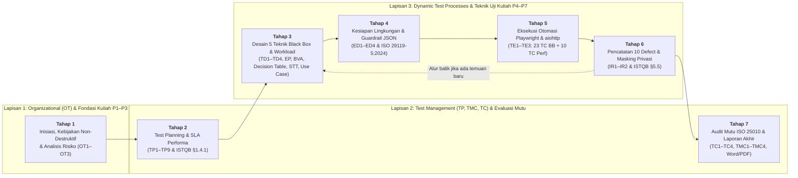

# Standar Dokumentasi QA & Testing IEEE / ISO (`>= 2022`)

Dokumen ini menjadi indeks acuan standar QA & Testing (`2022–2026`) pada repositori `tugas-qa-testing` untuk studi kasus **Portal Booking GOR Permata Badminton Hall** (`https://gorpermatabadminton.com`), agar memenuhi **Poin 2** instruksi perkuliahan serta patuh penuh pada standar resmi edisi **`>= 2022`** (**`ISO/IEC/IEEE 29119-1:2022`**, **`29119-5:2024`**, **`ISO/IEC 25010:2023`**, **`25019:2023`**, **`25002:2024`**, **`40500:2025`**, & **`ISTQB CTFL v4.0.1 2024`**).

---

## 1. Kerangka Standar Resmi (`>= 2022`) yang Dirujuk

| Standar Resmi | Tahun / Edisi | Fokus Utama & Penerapan di Proyek GOR Permata | Tautan Resmi |
| :--- | :---: | :--- | :--- |
| **ISO/IEC/IEEE 29119-1** *(Concepts and Definitions)* | **2022-01** *(Edisi ke-2)* | Membakukan arsitektur proses uji multi-lapis (`Organizational -> Management -> Dynamic`), struktur konseptual `Test Basis -> Test Model -> TCI -> Test Case -> Test Procedure -> Incident Report`, serta prinsip *risk-based testing* untuk memisahkan skenario aman (`In Scope`) dari submit DB nyata (`Out of Scope`). | [`iso.org/standard/81291.html`](https://www.iso.org/standard/81291.html) |
| **ISO/IEC/IEEE 29119-5** *(Keyword-Driven Testing)* | **2024-12** *(Edisi ke-2)* | Landasan modularisasi helper otomasi (`record`, `click_submit_expect_dialog`, `mask_grid_pii`) serta pemisahan dataset JSON ([`blackbox-testdata.json`](../03-hasil-pengujian/test-data/blackbox-testdata.json), [`performance-profiles.json`](../03-hasil-pengujian/test-data/performance-profiles.json)) pada skrip Playwright Python & Cypress di folder [`03-hasil-pengujian/`](../03-hasil-pengujian/). | [`iso.org/standard/87233.html`](https://www.iso.org/standard/87233.html) |
| **ISTQB CTFL Syllabus v4.0.1** *(Standar Terbuka Resmi)* | **2024-09** *(v4.0 / v4.0.1)* | Menguraikan *Test Process / Flow Testing* (`Bab 1.4`) dan teknik **Black Box** (*Equivalence Partitioning, Boundary Value Analysis, Decision Table, State Transition* pada `Bab 4.2`), serta merujuk resmi ke `ISO 29119-1:2022` dan `ISO 25010:2023`. | [`ISTQB_CTFL_Syllabus_v4.0.1_2024.pdf`](./pdf-standar/ISTQB_CTFL_Syllabus_v4.0.1_2024.pdf) |
| **ISO/IEC 25010** *(Product Quality Model — SQuaRE)* | **2023-11** *(Edisi ke-2, 9 Dimensi)* | Model kualitas produk perangkat lunak terbaru (**9 karakteristik**): *Functional Suitability, Performance Efficiency, Compatibility, **Interaction Capability**, Reliability, Security, Maintainability, **Flexibility**, dan **Safety***. | [`iso.org/standard/78176.html`](https://www.iso.org/standard/78176.html) |
| **ISO/IEC 25019** *(Quality-in-Use Model — SQuaRE)* | **2023-11** *(Edisi ke-1)* | Mengukur kualitas dari perspektif pemangku kepentingan & pengguna akhir (*Effectiveness, Efficiency, Freedom from Risk, Acceptability*) untuk dampak cacat pada pelanggan & pemilik GOR. | [`iso.org/standard/78177.html`](https://www.iso.org/standard/78177.html) |
| **ISO/IEC 25002** *(Quality Model Overview & Usage — SQuaRE)* | **2024-03** *(Edisi ke-1)* | Panduan struktur dan penggunaan model kualitas `SQuaRE` dalam menghubungkan metrik pengujian dengan evaluasi mutu. | [`iso.org/standard/78175.html`](https://www.iso.org/standard/78175.html) |
| **ISO/IEC 40500** *(W3C WCAG 2.2)* | **2025-09** / **2023** | Standar aksesibilitas & keterbacaan antarmuka lintas perangkat (*Reflow & Responsive Layout* Desktop vs Mobile `390×844`). | [`W3C_WCAG_2.2_Accessibility_2023_ISO_40500_2025.pdf`](./pdf-standar/W3C_WCAG_2.2_Accessibility_2023_ISO_40500_2025.pdf) |

---

## 2. Matriks Kepatuhan Artefak Proyek (Arsitektur ISO/IEC/IEEE 29119-1:2022 & SQuaRE 2023–2024)

| Lapisan / Referensi Proses | *Information Item* Wajib | Lokasi Berkas pada Repositori Ini | Fokus Cakupan |
| :---: | :--- | :--- | :--- |
| **Organizational (`OT1–OT3`)** | **Organizational Test Specification** (*Policy*, *Practices*, & *Conformance Statement*) | [`./organizational-test-specification.md`](./organizational-test-specification.md) | *Tailored Conformance*, kebijakan non-destruktif, konvensi ID, alur `Test Model`. |
| **7.2 (`TP1–TP9`)** | **Project / Master Test Plan** (`TP-GOR-01`) | [`../02-objek-umkm-dan-rencana-uji/test-plan-gor-permata.md`](../02-objek-umkm-dan-rencana-uji/test-plan-gor-permata.md) | Konteks, *Test Basis*, Risiko *Project vs Product* + *Exposure*, *Strategy*, *Schedule*, *Approval*. |
| **7.2 (`TP1–TP9`)** | **Performance Test Plan** (`TP-GOR-PERF-01`) | [`../02-objek-umkm-dan-rencana-uji/performance-test-plan.md`](../02-objek-umkm-dan-rencana-uji/performance-test-plan.md) | Strategi uji performa non-destruktif (`1/5/10 VUs` & *Web Vitals*), SLA/Threshold, *Circuit Breaker*. |
| **8.2 (`TD1–TD2`)** | **Test Model Specification & TCI** (*Black Box*) | [`../02-objek-umkm-dan-rencana-uji/test-model-blackbox.md`](../02-objek-umkm-dan-rencana-uji/test-model-blackbox.md) | `TB-BB-*`, `TM-BB-*` (`EP`, `BVA`, `Decision Table`, `STT`, `Use Case`), `TCI-BB-*`. |
| **8.2 (`TD1–TD2`)** | **Test Model Specification & TCI** (*Performance*) | [`../02-objek-umkm-dan-rencana-uji/test-model-performance.md`](../02-objek-umkm-dan-rencana-uji/test-model-performance.md) | `TB-PERF-*`, `TM-PERF-*` (*CWV*, *Interaction Timing*, *Workload `1/5/10 VUs`*), `TCI-PERF-*`. |
| **8.2 (`TD1–TD2`)** | **Analisis Pelengkap (*White/Gray Box*)** | [`../02-objek-umkm-dan-rencana-uji/analisis-white-black-gray-box.md`](../02-objek-umkm-dan-rencana-uji/analisis-white-black-gray-box.md) | *Control Flow Graph*, $V(G)$, *Basis Path*, analisis CSRF & DOM, serta tautan ke model Black Box. |
| **8.2 (`TD3–TD4`)** | **Test Case & Test Procedure Specs** (*Black Box*) | [`../03-hasil-pengujian/test-case-blackbox.md`](../03-hasil-pengujian/test-case-blackbox.md) | `TC-BB-*`, `PROC-BB-*`, *Traceability Matrix* penuh, & skrip Playwright/Cypress. |
| **8.2 (`TD3–TD4`)** | **Test Case & Test Procedure Specs** (*Performance*) | [`../03-hasil-pengujian/test-case-performance.md`](../03-hasil-pengujian/test-case-performance.md) | `TC-PERF-*`, `PROC-PERF-*`, *Traceability Matrix* penuh, & skrip [`test_performance_gor_permata.py`](../03-hasil-pengujian/automation-scripts/test_performance_gor_permata.py). |
| **8.3 (`ED1–ED4`)** | **Test Environment & Data Readiness Reports** | [`../03-hasil-pengujian/test-environment-dan-data.md`](../03-hasil-pengujian/test-environment-dan-data.md) | Kesiapan environment, beda Test vs Operational (`8.3.4.2 c`), serta dataset `test-data/*.json`. |
| **8.4 (`TE1–TE3`)** | **Test Results & Test Execution Log** | [`../03-hasil-pengujian/test-execution-log.md`](../03-hasil-pengujian/test-execution-log.md) | Rekaman hasil aktual vs ekspektasi, log TXT mentah, JSON metrik performa, & screenshot bukti. |
| **8.5 (`IR1–IR2`)** | **Incident Reports** | [`../03-hasil-pengujian/incident-reports.md`](../03-hasil-pengujian/incident-reports.md) | Pelaporan terstandar (`IR-GOR-01..NN`), *Severity/Priority*, status retest, dan *action items*. |
| **7.3 (`TMC1–TMC4`)** | **Test Status, Risk Updates & Control Directives** | [`../03-hasil-pengujian/test-status-and-control-report.md`](../03-hasil-pengujian/test-status-and-control-report.md) | Pemantauan metrik cakupan, pembaruan risiko, *control directives*, dan kesiapan *Exit Criteria*. |
| **7.4 (`TC1–TC4`)** | **Test Completion Report** | [`../03-hasil-pengujian/test-completion-report.md`](../03-hasil-pengujian/test-completion-report.md) | Evaluasi *Completion Criteria*, aset terarsip, pembersihan environment, *Lessons Learned*, *Sign-off*. |
| **ISO 25010:2023** | **Evaluasi Mutu Produk (9 Karakteristik)** | [`./evaluasi-iso-25010-gor-permata.md`](./evaluasi-iso-25010-gor-permata.md) | Evaluasi 9 dimensi mutu termasuk angka performa & kompatibilitas hasil eksekusi aktual. |

---

## 2.1 Alur Pengujian (*Test Flow 7 Tahap*): Penyelarasan Materi Kuliah (P1–P7) & Standar ISO/IEEE/ISTQB

Seluruh alur pengujian dari awal hingga pelaporan akhir (*documentation*) dipetakan secara terstruktur mengikuti tiga lapisan arsitektur **ISO/IEC/IEEE 29119-1:2022** dan topik **Materi Perkuliahan (Pertemuan 1–7)**:

### Matriks Pemetaan Test Flow End-to-End

| Tahapan STLC | Modul Perkuliahan Terkait | Standar ISO / IEEE / ISTQB | Aktivitas Inti Pengujian | Dokumen Hasil (Deliverables) |
| :--- | :--- | :--- | :--- | :--- |
| **1. Requirements & Risk Analysis** | **Pertemuan 1** (Definisi QA & ISO 9000), **P2** (Faktor Mutu), **P3** (Misi Tim, Psikologi, & *Risk-Based Testing*) | `ISO/IEC/IEEE 29119-1:2022` Clause 6 (`OT1–OT3`) | Menentukan batasan *In Scope* (rute publik, form modal) vs *Out of Scope* (submit DB asli & akses admin); menghitung *Risk Exposure* (`Likelihood × Impact`). | [`organizational-test-specification.md`](./organizational-test-specification.md) |
| **2. Test Planning** | **Pertemuan 1–3** (Obyektifitas Pengujian & Target Mutu Organisasi) | `ISO/IEC/IEEE 29119-1:2022` Clause 7.2 (`TP1–TP9`), `ISTQB CTFL v4.0.1` §1.4.1 | Menyusun *Master Test Plan* & *Performance Test Plan*, target batas waktu *Web Vitals* (*TTFB, FCP, LCP*), serta justifikasi dari 9 jurnal SINTA 2–3 (`2022–2026`). | [`test-plan-gor-permata.md`](../02-objek-umkm-dan-rencana-uji/test-plan-gor-permata.md), [`performance-test-plan.md`](../02-objek-umkm-dan-rencana-uji/performance-test-plan.md) |
| **3. Test Design** | **Pertemuan 4–5** (Struktur Logika/CFG pembacaan kode pendukung), **P6** (Black Box: *EP, BVA*), **P7** (*Decision Table, STT, Use Case*) | `ISO/IEC/IEEE 29119-1:2022` Clause 8.2 (`TD1–TD4`), `ISTQB CTFL v4.0.1` Bab 4.2 | Menurunkan rantai tertelusur: `Test Basis -> Test Model -> TCI -> Test Case -> Test Procedure` untuk 5 teknik Black Box (`23 TC`) & model beban performa 1/5/10 VUs (`10 TC`). | [`test-model-blackbox.md`](../02-objek-umkm-dan-rencana-uji/test-model-blackbox.md), [`test-model-performance.md`](../02-objek-umkm-dan-rencana-uji/test-model-performance.md), [`test-case-blackbox.md`](../03-hasil-pengujian/test-case-blackbox.md), [`test-case-performance.md`](../03-hasil-pengujian/test-case-performance.md) |
| **4. Test Implementation & Environment** | Modul Lanjutan (*Automation Testing*) & Pemisahan Dataset Uji | `ISO/IEC/IEEE 29119-1:2022` Clause 8.3 (`ED1–ED4`), `ISO/IEC/IEEE 29119-5:2024` (*Keyword-Driven*) | Menyiapkan dataset JSON terpisah; memasang rem interseptor browser (`page.route`) untuk memblokir `POST /bookings/store` agar **0 booking fiktif tersimpan ke DB riil**, serta proteksi *circuit breaker*. | [`test-environment-dan-data.md`](../03-hasil-pengujian/test-environment-dan-data.md), [`test-data/`](../03-hasil-pengujian/test-data/) |
| **5. Test Execution** | Modul Lanjutan (*Otomasi Pengujian dengan Playwright & aiohttp*) | `ISO/IEC/IEEE 29119-1:2022` Clause 8.4 (`TE1–TE3`) | Mengeksekusi skrip otomasi [`test_gor_permata.py`](../03-hasil-pengujian/automation-scripts/test_gor_permata.py) (`23 TC BB`) dan [`test_performance_gor_permata.py`](../03-hasil-pengujian/automation-scripts/test_performance_gor_permata.py) (`10 TC Perf`, `104` GET request) di Desktop & Mobile; mencatat rekaman hasil aktual vs ekspektasi. | [`test-execution-log.md`](../03-hasil-pengujian/test-execution-log.md), file log mentah & [`evidence/`](../03-hasil-pengujian/evidence/) |
| **6. Incident / Defect Reporting** | **Pertemuan 3** (Psikologi Pengujian & Siklus Hidup Cacat/Defect) | `ISO/IEC/IEEE 29119-1:2022` Clause 8.5 (`IR1–IR2`), `ISTQB CTFL v4.0.1` Bab 5.5 | Mendokumentasikan 10 insiden terverifikasi ([`incident-reports.md`](../03-hasil-pengujian/incident-reports.md)), menentukan *Severity/Priority*, dan menyamarkan nama pemesan lain di screenshot jadwal menjadi `[TERISI]` demi privasi. | [`incident-reports.md`](../03-hasil-pengujian/incident-reports.md), [`evidence/screenshots/`](../03-hasil-pengujian/evidence/screenshots/) |
| **7. Test Reporting & Completion** | **Pertemuan 2** (Model Kualitas Software) & Kriteria Selesai Uji | `ISO/IEC/IEEE 29119-1:2022` Clause 7.3 & 7.4 (`TC1–TC4`), `ISO/IEC 25010:2023`, `ISO 25019:2023` | Memverifikasi pemenuhan 100% *Exit Criteria*, mengaudit mutu produk dengan 9 karakteristik ISO 25010, membersihkan lingkungan, mengarsipkan artefak uji, dan mencetak **Laporan Akhir Word & PDF**. | [`test-status-and-control-report.md`](../03-hasil-pengujian/test-status-and-control-report.md), [`test-completion-report.md`](../03-hasil-pengujian/test-completion-report.md), [`evaluasi-iso-25010-gor-permata.md`](./evaluasi-iso-25010-gor-permata.md), [`05-dokumentasi-laporan/`](../05-dokumentasi-laporan/) |

---

## 3. Template Baku Laporan Insiden / Defect (ISO/IEC/IEEE 29119-1:2022)

Setiap temuan cacat atau pelanggaran SLA performa pada **GOR Permata Badminton Hall** dicatat pada [`incident-reports.md`](../03-hasil-pengujian/incident-reports.md) dengan atribut minimal:
1. **ID Insiden & Cross-Ref:** Kode unik (`IR-GOR-XX` / `BUG-GOR-XX`) dan `TC` pemicu
2. **Kategori & Status Siklus Hidup:** (`Functional / Validation / Error Handling / Performance / Security / Privacy`) dan status (`Open / Reported / Retest Pending / Closed`)
3. **Severity / Priority:** *Critical / Major / Minor* dan *High / Medium / Low*
4. **URL / Modul Terdampak & Test Environment**
5. **Steps to Reproduce:** Langkah deterministik non-destruktif yang dapat diulang penguji lain
6. **Expected Result vs Actual Result**
7. **Bukti Verifikasi Teknis & Action Item:** Respons HTTP, metrik/persentil, cuplikan DOM/JS, tangkapan layar, atau log eksekusi skrip otomasi beserta pemilik tindak lanjut

---

## 4. Referensi Resmi (`>= 2022`) & Arsip PDF di [`./pdf-standar/`](./pdf-standar/)

- **Kanal Resmi Katalog & Pratinjau Standar (`iso.org`, `w3.org`, `istqb.org`):**
  - **ISO/IEC/IEEE 29119-1:2022 (*General Concepts*):** [`iso.org/standard/81291.html`](https://www.iso.org/standard/81291.html)
  - **ISO/IEC/IEEE 29119-5:2024 (*Keyword-Driven Testing*):** [`iso.org/standard/87233.html`](https://www.iso.org/standard/87233.html)
  - **ISO/IEC 25010:2023 (*Product Quality Model*):** [`iso.org/standard/78176.html`](https://www.iso.org/standard/78176.html)
  - **ISO/IEC 25019:2023 (*Quality-in-Use Model*):** [`iso.org/standard/78177.html`](https://www.iso.org/standard/78177.html)
  - **ISO/IEC 25002:2024 (*Quality Model Overview & Usage*):** [`iso.org/standard/78175.html`](https://www.iso.org/standard/78175.html)
  - **ISO/IEC 40500:2025 / W3C WCAG 2.2:** [`iso.org/standard/91029.html`](https://www.iso.org/standard/91029.html) & [`w3.org/TR/WCAG22/`](https://www.w3.org/TR/WCAG22/)
  - **ISTQB CTFL Syllabus v4.0.1 (`2024`):** [`istqb.org CTFL v4.0`](https://www.istqb.org/certifications/certified-tester-foundation-level-ctfl-v4-0/)
  - **ISO Online Browsing Platform (OBP):** [`iso.org/obp/ui/en/`](https://www.iso.org/obp/ui/en/)
- **Berkas PDF Acuan (`>= 2022`) pada [`./pdf-standar/`](./pdf-standar/) (Klik untuk Membuka):**
  - [`iso-iec-ieee-29119-5-2024_compress.pdf`](./pdf-standar/iso-iec-ieee-29119-5-2024_compress.pdf) — Standar resmi **ISO/IEC/IEEE 29119-5:2024** (*Keyword-Driven Testing*).
  - [`ISTQB_CTFL_Syllabus_v4.0.1_2024.pdf`](./pdf-standar/ISTQB_CTFL_Syllabus_v4.0.1_2024.pdf) — Standar resmi terbuka **ISTQB CTFL v4.0.1** (`2024`, `78` halaman: *Test Process*, `EP`, `BVA`, `Decision Table`, `State Transition`).
  - [`W3C_WCAG_2.2_Accessibility_2023_ISO_40500_2025.pdf`](./pdf-standar/W3C_WCAG_2.2_Accessibility_2023_ISO_40500_2025.pdf) — Standar aksesibilitas & kompatibilitas **W3C WCAG 2.2** (`96` halaman, diadopsi menjadi **ISO/IEC 40500:2025**).
  - [`Referensi-Standar-ISO-Testing-dan-Kualitas-2022-2025.pdf`](./pdf-standar/Referensi-Standar-ISO-Testing-dan-Kualitas-2022-2025.pdf) — Peta lengkap **6 standar ISO `>= 2022`** beserta tautan resmi dan implementasinya pada proyek GOR Permata.
  - [`Ringkasan-Standar-ISO-IEC-IEEE-29119-2022-2024.pdf`](./pdf-standar/Ringkasan-Standar-ISO-IEC-IEEE-29119-2022-2024.pdf) — Ringkasan struktur, konsep `29119-1:2022`, otomasi modular `29119-5:2024`, & matriks artefak (`23 TC` BB & `10 TC` Perf).
  - [`Audit-Mutu-ISO-IEC-25010-2023-GOR-Permata.pdf`](./pdf-standar/Audit-Mutu-ISO-IEC-25010-2023-GOR-Permata.pdf) — Ringkasan hasil audit 9 karakteristik **ISO/IEC 25010:2023** & **ISO/IEC 25019:2023** pada GOR Permata.
