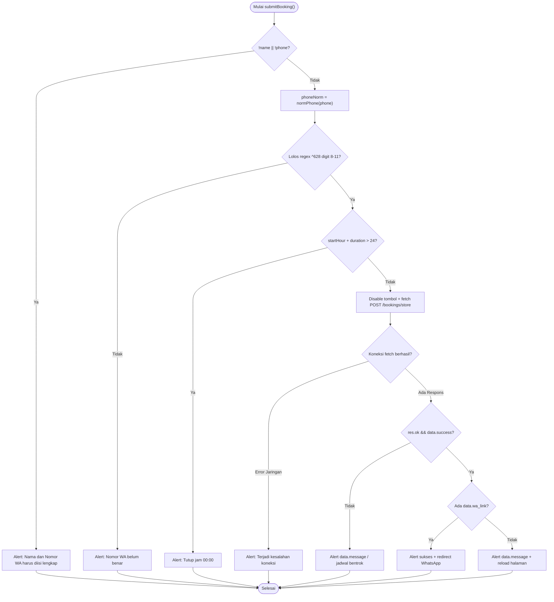

# Analisis White Box, Black Box, dan Gray Box: GOR Permata Badminton Hall

Analisis disusun langsung dari pengamatan halaman publik `https://gorpermatabadminton.com/booking`, `/`, dan `/login` (diverifikasi 14 November 2026) mengacu pada **ISO/IEC/IEEE 29119-4** serta rujukan jurnal terakreditasi **SINTA 2–3** ([`referensi-sinta-1-3.md`](./referensi-sinta-1-3.md)).

---

## 1. White Box Testing & Perhitungan Cyclomatic Complexity ($V(G)$)

Sesuai kajian **Pratala, dkk. (2020)** (*JIUP, SINTA 3*) dan **Alirridlo, dkk. (2025)** (*Jurnal RESTI, SINTA 2*), kompleksitas logika percabangan dievaluasi menggunakan *Control Flow Graph (CFG)* dan teknik **Basis Path** dengan rumus McCabe $V(G) = E - N + 2 = P + 1$.

Pada `/booking`, terdapat skrip JavaScript klien terbuka sepanjang `7.456` karakter yang mengatur interaksi pemesanan. Berikut analisis *Flow Graph* pada dua fungsi inti: `normPhone()` dan `submitBooking()`.

---

### A. Fungsi `normPhone(p)`

```javascript
const normPhone = (p) => {
    let d = String(p).replace(/\D+/g, '');
    if (d.startsWith('62')) return d;
    if (d.startsWith('0'))  return '62' + d.slice(1);
    if (d.startsWith('8'))  return '62' + d;
    return d;
};
```

#### Control Flow Graph (`normPhone`)


#### Perhitungan Kompleksitas Siklomatik
- **Jumlah predikat keputusan ($P$):** 3 buah `if` (`startsWith('62')`, `startsWith('0')`, `startsWith('8')`).
- **Jumlah simpul ($N$) & sisi ($E$) pada grafik:** $N = 10$, $E = 12$.
- **Cyclomatic Complexity:** $V(G) = E - N + 2 = 12 - 10 + 2 = \mathbf{4}$ (setara dengan $P + 1 = 3 + 1 = \mathbf{4}$).

#### Pemetaan 4 Independent Basis Paths (`normPhone`)

| ID Path | Lintasan Grafik | Data Uji Input | Output `normPhone()` | Lolos Regex `/^628\d{8,11}$/`? |
| :--- | :--- | :--- | :--- | :---: |
| **Basis Path 1** | `S -> N1 -> D1(Ya) -> R1 -> E` | `"628123456789"` | `"628123456789"` | **Ya** |
| **Basis Path 1b (Bug)** | `S -> N1 -> D1(Ya) -> R1 -> E` | `"+62 08123456789"` | `"6208123456789"` | **Gagal** (`BUG-GOR-02`) |
| **Basis Path 2** | `S -> N1 -> D1(Tidak) -> D2(Ya) -> R2 -> E` | `"08123456789"` | `"628123456789"` | **Ya** |
| **Basis Path 3** | `S -> N1 -> D1(Tidak) -> D2(Tidak) -> D3(Ya) -> R3 -> E` | `"8123456789"` | `"628123456789"` | **Ya** |
| **Basis Path 4** | `S -> N1 -> D1(Tidak) -> D2(Tidak) -> D3(Tidak) -> R4 -> E` | `"12345"` / `"abc"` | `"12345"` / `""` | **Tidak (Ditolak)** |

- **Temuan Logika (*White Box Defect*):** Karena kondisi `d.startsWith('62')` langsung melakukan `return d` sebelum menghapus angka `0` setelah `62`, masukan bernilai sah seperti `+62 08123456789` berubah menjadi `6208123456789` dan gagal di tahap regex berikutnya (`BUG-GOR-02`).

---

### B. Fungsi `submitBooking()`

Struktur cabang keputusan aktual pada skrip inline `/booking`:
1. `if (!name || !phone)` — validasi wajib isi (*2 kondisi atomik:* `!name`, `!phone`).
2. `if (!/^628\d{8,11}$/.test(phoneNorm))` — validasi format dan panjang nomor WhatsApp (`628` + 8 s.d. 11 digit = 11–14 digit).
3. `if (startHour + duration > 24)` — validasi batas jam tutup operasional `00:00`.
4. `.then(...) if (res.ok && data.success)` — percabangan keberhasilan API (*2 kondisi atomik:* `res.ok`, `data.success`).
5. `if (data.wa_link)` — percabangan redirect ke WhatsApp vs `location.reload()`.
6. `.catch(...)` — jalur penanganan kegagalan jaringan.

#### Control Flow Graph (`submitBooking`)



#### Perhitungan Kompleksitas Siklomatik & Basis Path
- **Tingkat Blok Keputusan (*Simple/Branch Decisions*):** $N = 17$, $E = 22$, sehingga $V(G) = 22 - 17 + 2 = \mathbf{7}$ jalur independen (sesuai $P + 1 = 6 + 1 = \mathbf{7}$).
- **Tingkat Kondisi Atomik (*Condition Coverage*):** Jika predikat majemuk (`!name || !phone` dan `res.ok && data.success`) dipecah menjadi kondisi atomik, terdapat 8 kondisi predikat sehingga $V(G) = 8 + 1 = \mathbf{9}$ jalur uji basis kondisi.

| ID Path | Lintasan Ringkas | Data / Kondisi Uji | Aman Diulang Tanpa Ubah DB? |
| :--- | :--- | :--- | :---: |
| **BP-1** | `S -> D1(Ya) -> A1 -> E` | `#custName = ""` atau `#custPhone = ""` (`TC-GOR-06`) | **Ya** *(berhenti di klien)* |
| **BP-2** | `S -> D1(Tidak) -> P1 -> D2(Tidak) -> A2 -> E` | `name = "Test QA"`, `phone = "12345"` / `"+62 08123456789"` (`TC-GOR-07`, `TC-GOR-08`) | **Ya** *(berhenti di klien)* |
| **BP-3** | `S -> ... -> D2(Ya) -> D3(Ya) -> A3 -> E` | Slot `22:00`, `duration = 3`, WA valid (`TC-GOR-09`) | **Ya** *(berhenti di klien)* |
| **BP-4** | `S -> ... -> D3(Tidak) -> F -> D4(Error) -> C1 -> E` | Semua valid namun request jaringan gagal/diblokir (*interceptor* otomasi) | **Ya** *(diblokir via `page.route`)* |
| **BP-5** | `S -> ... -> D4(OK) -> D5(Tidak) -> F1 -> E` | Server membalas `success: false` / bentrok jadwal | **Out of Scope** *(butuh DB/mock)* |
| **BP-6** | `S -> ... -> D5(Ya) -> D6(Ya) -> W1 -> E` | Booking sukses dengan tautan `wa_link` | **Out of Scope** *(cegah order fiktif)* |
| **BP-7** | `S -> ... -> D5(Ya) -> D6(Tidak) -> W2 -> E` | Booking sukses tanpa `wa_link`, halaman me-reload | **Out of Scope** *(cegah order fiktif)* |

---

## 2. Black Box Testing

Mengacu pada **Yulistina, dkk. (2020)**, **Nurudin, dkk. (2019)** (*JIUP, SINTA 3*), serta **Putri & Susanto (2024)** (*Sinkron, SINTA 3*), perancangan kasus uji Black Box berfokus pada **Equivalence Partitioning (EP)**, **Boundary Value Analysis (BVA)**, **State Transition**, dan **Use Case Testing**.

### A. Equivalence Partitioning (EP) & Boundary Value Analysis (BVA)

| Parameter / Field | Partisi Valid | Partisi Tidak Valid | Nilai Batas (*BVA*) |
| :--- | :--- | :--- | :--- |
| **Nama Pemesan (`#custName`)** | String non-kosong (mis. `"Faiz"`) | String kosong `""` | Panjang `0` (ditolak) vs `1` karakter atau spasi `"   "` (lolos JS klien — tercatat sebagai `BUG-GOR-03`) |
| **Nomor WhatsApp (`#custPhone`)** | `08xxxxxxxxxx`, `628xxxxxxxxxx`, `8xxxxxxxxxx` (setara `628` + 8–11 digit = 11–14 digit) | Kosong, huruf `"abc"`, nomor di bawah 11 digit, atau di atas 14 digit | **7 digit setelah `628`** (`081234567` -> ditolak), **8 digit setelah `628`** (`0812345678` -> valid), **11 digit setelah `628`** (`0812345678901` -> valid), **12 digit setelah `628`** (`08123456789012` -> ditolak) |
| **Durasi Main (`#custDuration`)** | Bilangan bulat positif di mana `startHour + duration <= 24` | Nilai di mana `startHour + duration > 24` | Slot jam `22:00`: durasi `2` jam (`24 <= 24` -> valid, total `Rp 80.000`) vs durasi `3` jam (`25 > 24` -> ditolak alert jam tutup) |
| **Parameter URL `start_date`** | Format `YYYY-MM-DD` valid | Format salah / tanggal non-valid | Perubahan tanggal lewat `#jumpDate` memicu `changeDate(date)` |

### B. State Transition Testing (Status Slot di Grid `/booking`)
- `Kosong (tombol +)` -> klik slot -> `Modal Booking Terbuka` (`openBooking`)
- `Modal Booking Terbuka` -> klik Batal/Tutup (`closeModal`) -> `Modal Tertutup & Input Ter-reset`
- `Modal Booking Terbuka` -> input invalid -> `Alert Validasi Klien (Tetap di Modal)`
- `Modal Booking Terbuka` -> submit valid *(dibatasi di environment nyata)* -> `Status Slot: Menunggu` -> Admin konfirmasi -> `Status Slot: Terisi` / `Member`

### C. Use Case Testing
- **UC-01:** Pengunjung membuka beranda -> klik menu Booking -> memilih tanggal -> melihat tarif lapangan (`Rp 40.000`/jam -> `Rp 80.000`/2 jam -> dst.) -> membatalkan modal.
- **UC-02:** Pengunjung mencari halaman pendaftaran (`/register`) -> sistem gagal menemukan halaman (`404`).

---

## 3. Gray Box Testing
- **Struktur Token & Request Header:** Halaman `/booking` menyisipkan variabel global `const CSRF = '...'` di JS inline dan mengirimkannya pada header `X-CSRF-TOKEN` saat memanggil `https://gorpermatabadminton.com/bookings/store`.
- **Inspeksi Data Slot DOM & Informasi Internal:** Fungsi `manageBooking(el)` membaca atribut `data-status`, `data-name`, `data-phone`, `data-date`, `data-court`, `data-start`, `data-end`, `data-duration`, `data-price` langsung dari DOM, dan memiliki *flag* sisi klien `const isAdmin = false; const isGuard = false;` serta teks internal (`Hubungi Koko atau Aan.`) (`BUG-GOR-04`).
- **Pemeriksaan *HTTP Response Headers* Pasif:** Rute `/`, `/booking`, dan `/login` dilayani melalui `Server: hcdn` dengan `Content-Security-Policy: upgrade-insecure-requests`, namun **4 header keamanan standar belum terpasang** (`Strict-Transport-Security`, `X-Frame-Options`, `X-Content-Type-Options`, `Referrer-Policy`) — rincian dampak tercatat pada [`../01-standar-ieee-iso/evaluasi-iso-25010-gor-permata.md`](../01-standar-ieee-iso/evaluasi-iso-25010-gor-permata.md).
