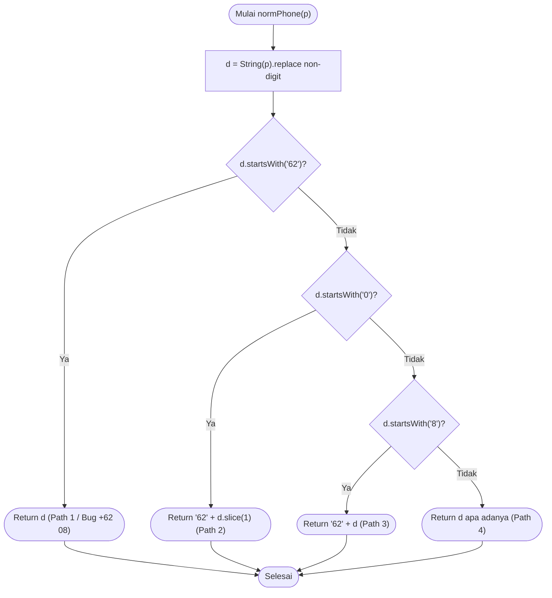

# Analisis White Box, Black Box, dan Gray Box: GOR Permata Badminton Hall

Analisis disusun langsung dari pengamatan halaman publik `https://gorpermatabadminton.com/booking`, `/`, dan `/login` mengacu pada standar minimal tahun `2022` (**ISO/IEC/IEEE 29119-1:2022**, **ISTQB CTFL Syllabus v4.0.1 `2024`**, **ISO/IEC 25010:2023**) serta rujukan jurnal terakreditasi **SINTA 2–3 (`2022–2026`)** ([`referensi-sinta-1-3.md`](./referensi-sinta-1-3.md)). Dokumen ini berfokus pada analisis struktur kode (**White Box**) dan informasi internal (**Gray Box**), sementara permodelan penuh **Black Box** dan **Performance Testing** dirinci pada [`test-model-blackbox.md`](./test-model-blackbox.md) dan [`test-model-performance.md`](./test-model-performance.md).

---

## 1. White Box Testing & Perhitungan Cyclomatic Complexity ($V(G)$)

Sesuai kajian **Nada, dkk. (2023)** (*JIUP UNPAM, SINTA 3*, `DOI: 10.32493/informatika.v8i3.33711`) dan **Alirridlo, dkk. (2025)** (*Jurnal RESTI, SINTA 2*, `DOI: 10.29207/resti.v9i6.6825`), kompleksitas logika percabangan dievaluasi menggunakan *Control Flow Graph (CFG)* dan teknik **Basis Path** dengan rumus McCabe $V(G) = E - N + 2 = P + 1$.

Pada `/booking`, terdapat skrip JavaScript klien terbuka sepanjang `7.473` karakter yang mengatur interaksi pemesanan. Berikut analisis *Flow Graph* pada dua fungsi inti: `normPhone()` dan `submitBooking()`.

---

### A. Fungsi `normPhone(p)`

```javascript
const normPhone = (p) => {
    let d = String(p).replace(/\D+/g, '');
    if (d.startsWith('62')) return d;
    if (d.startsWith('0'))  return '62' + d.slice(1);
    if (d.startsWith('8'))  return '62' + d;
    return d;
};
```

#### Control Flow Graph (`normPhone`)



#### Perhitungan Kompleksitas Siklomatik
- **Jumlah predikat keputusan ($P$):** 3 buah `if` (`startsWith('62')`, `startsWith('0')`, `startsWith('8')`).
- **Jumlah simpul ($N$) & sisi ($E$) pada grafik:** $N = 10$, $E = 12$.
- **Cyclomatic Complexity:** $V(G) = E - N + 2 = 12 - 10 + 2 = \mathbf{4}$ (setara dengan $P + 1 = 3 + 1 = \mathbf{4}$).

#### Pemetaan 4 Independent Basis Paths (`normPhone`)

| ID Path | Lintasan Grafik | Data Uji Input | Output `normPhone()` | Lolos Regex `/^628\d{8,11}$/`? |
| :--- | :--- | :--- | :--- | :---: |
| **Basis Path 1** | `S -> N1 -> D1(Ya) -> R1 -> E` | `"628123456789"` | `"628123456789"` | **Ya** |
| **Basis Path 1b (Bug)** | `S -> N1 -> D1(Ya) -> R1 -> E` | `"+62 08123456789"` | `"6208123456789"` | **Gagal** (`BUG-GOR-02` / `IR-GOR-02`) |
| **Basis Path 2** | `S -> N1 -> D1(Tidak) -> D2(Ya) -> R2 -> E` | `"08123456789"` | `"628123456789"` | **Ya** |
| **Basis Path 3** | `S -> N1 -> D1(Tidak) -> D2(Tidak) -> D3(Ya) -> R3 -> E` | `"8123456789"` | `"628123456789"` | **Ya** |
| **Basis Path 4** | `S -> N1 -> D1(Tidak) -> D2(Tidak) -> D3(Tidak) -> R4 -> E` | `"12345"` / `"abc"` | `"12345"` / `""` | **Tidak (Ditolak)** |

- **Temuan Logika (*White Box Defect*):** Karena kondisi `d.startsWith('62')` langsung melakukan `return d` sebelum menghapus angka `0` setelah `62`, masukan bernilai sah seperti `+62 08123456789` berubah menjadi `6208123456789` dan gagal di tahap regex berikutnya (`IR-GOR-02`).

---

### B. Fungsi `submitBooking()`

Struktur cabang keputusan aktual pada skrip inline `/booking`:
1. `if (!name || !phone)` — validasi wajib isi (*2 kondisi atomik:* `!name`, `!phone`).
2. `if (!/^628\d{8,11}$/.test(phoneNorm))` — validasi format dan panjang nomor WhatsApp (`628` + 8 s.d. 11 digit = 11–14 digit).
3. `if (startHour + duration > 24)` — validasi batas jam tutup operasional `00:00`.
4. `.then(...) if (res.ok && data.success)` — percabangan keberhasilan API (*2 kondisi atomik:* `res.ok`, `data.success`).
5. `if (data.wa_link)` — percabangan redirect ke WhatsApp vs `location.reload()`.
6. `.catch(...)` — jalur penanganan kegagalan jaringan.

#### Control Flow Graph (`submitBooking`)


#### Perhitungan Kompleksitas Siklomatik & Basis Path
- **Tingkat Blok Keputusan (*Simple/Branch Decisions*):** $N = 17$, $E = 22$, sehingga $V(G) = 22 - 17 + 2 = \mathbf{7}$ jalur independen (sesuai $P + 1 = 6 + 1 = \mathbf{7}$).
- **Tingkat Kondisi Atomik (*Condition Coverage*):** Jika predikat majemuk (`!name || !phone` dan `res.ok && data.success`) dipecah menjadi kondisi atomik, terdapat 8 kondisi predikat sehingga $V(G) = 8 + 1 = \mathbf{9}$ jalur uji basis kondisi.

| ID Path | Lintasan Ringkas | Data / Kondisi Uji | Aman Diulang Tanpa Ubah DB? |
| :--- | :--- | :--- | :---: |
| **BP-1** | `S -> D1(Ya) -> A1 -> E` | `#custName = ""` atau `#custPhone = ""` (`TC-BB-08`) | **Ya** *(berhenti di klien)* |
| **BP-2** | `S -> D1(Tidak) -> P1 -> D2(Tidak) -> A2 -> E` | `name = "Test QA"`, `phone = "12345"` / `"+62 08123456789"` (`TC-BB-10`, `TC-BB-16`) | **Ya** *(berhenti di klien)* |
| **BP-3** | `S -> ... -> D2(Ya) -> D3(Ya) -> A3 -> E` | Slot `22:00`, `duration = 3`, WA valid (`TC-BB-17`) | **Ya** *(berhenti di klien)* |
| **BP-4** | `S -> ... -> D3(Tidak) -> F -> D4(Error) -> C1 -> E` | Semua valid namun request jaringan dicegat (`TC-BB-09/12/13/15/18`) | **Ya** *(diblokir via `page.route`)* |
| **BP-5** | `S -> ... -> D4(OK) -> D5(Tidak) -> F1 -> E` | Server membalas `success: false` / bentrok jadwal | **Out of Scope** *(butuh DB/mock)* |
| **BP-6** | `S -> ... -> D5(Ya) -> D6(Ya) -> W1 -> E` | Booking sukses dengan tautan `wa_link` | **Out of Scope** *(cegah order fiktif)* |
| **BP-7** | `S -> ... -> D5(Ya) -> D6(Tidak) -> W2 -> E` | Booking sukses tanpa `wa_link`, halaman me-reload | **Out of Scope** *(cegah order fiktif)* |

---

## 2. Black Box Testing & Performance Testing (Rujukan *Test Model* `>= 2022`)

Mengacu pada arsitektur `Test Basis -> Test Model -> TCI` (**ISO/IEC/IEEE 29119-1:2022** & **ISTQB CTFL v4.0.1 2024**), spesifikasi lengkap **Test Basis**, **Test Model (`TD1`)**, **Alasan Pemilihan 5 Jenis Black Box**, dan **Test Coverage Items (`TD2`)** dipisahkan ke dokumen khusus:
- **Black Box Testing (*Equivalence Partitioning, Boundary Value Analysis, Decision Table, State Transition, Use Case*):** [`test-model-blackbox.md`](./test-model-blackbox.md) -> diturunkan ke [`../03-hasil-pengujian/test-case-blackbox.md`](../03-hasil-pengujian/test-case-blackbox.md).
- **Performance Testing (*Web Vitals, Resource Payload, Client Interaction, Concurrent `1/5/10 VUs` Workload*):** [`test-model-performance.md`](./test-model-performance.md) -> diturunkan ke [`../03-hasil-pengujian/test-case-performance.md`](../03-hasil-pengujian/test-case-performance.md).

---

## 3. Gray Box Testing
- **Struktur Token & Request Header:** Halaman `/booking` menyisipkan variabel global `const CSRF = '...'` di JS inline dan mengirimkannya pada header `X-CSRF-TOKEN` saat memanggil `https://gorpermatabadminton.com/bookings/store`; halaman `/login` juga menyertakan `<input type="hidden" name="_token">`.
- **Inspeksi Data Slot DOM & Informasi Internal:** Fungsi `manageBooking(el)` membaca atribut `data-status`, `data-name`, `data-phone`, `data-date`, `data-court`, `data-start`, `data-end`, `data-duration`, `data-price` langsung dari DOM publik (terverifikasi ratusan elemen slot terisi memuat `data-phone` & `data-name` non-kosong di HTML publik — tercatat pada `IR-GOR-04`), dan memiliki *flag* sisi klien `const isAdmin = false; const isGuard = false;` serta teks internal (`Hubungi Koko atau Aan.`).
- **Pemeriksaan *HTTP Response Headers* Pasif:** Rute `/`, `/booking`, dan `/login` dilayani melalui `Server: hcdn` dengan `Content-Security-Policy: upgrade-insecure-requests`, namun **4 header keamanan standar belum terpasang** (`Strict-Transport-Security`, `X-Frame-Options`, `X-Content-Type-Options`, `Referrer-Policy`) — rincian dampak tercatat pada [`../01-standar-ieee-iso/evaluasi-iso-25010-gor-permata.md`](../01-standar-ieee-iso/evaluasi-iso-25010-gor-permata.md).
