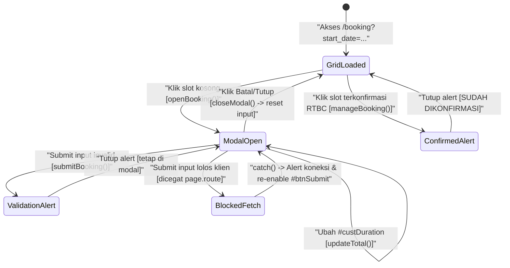

# Test Model Specification & Coverage Items — Black Box Testing (`TD1` & `TD2`)

Dokumen ini mengimplementasikan aktivitas **`TD1` (*Create test model*)** dan **`TD2` (*Identify test coverage items*)** sesuai standar resmi **`>= 2022`**: **ISO/IEC/IEEE 29119-1:2022**, **ISTQB CTFL Syllabus v4.0.1 (`2024`, Bab 4.2 Black-Box Test Techniques)**, dan **ISO/IEC 40500:2025 (W3C WCAG 2.2)** untuk **Black Box Testing** pada **Portal Booking GOR Permata Badminton Hall** (`https://gorpermatabadminton.com`).

---

## 0. Ringkasan Bahasa Mudah Dipahami & Cara Pakai Script

- **Dokumen ini isinya apa?** Ini adalah **"Cetakan Rancangan Skenario Black Box"**: menjelaskan bagian website mana saja yang dites, contoh input benar/salah apa yang dipakai (seperti nama kosong, panjang nomor WA `10/11/14/15` digit, dan aturan tutup jam `00:00`), serta daftar `23` hal yang wajib dites (`TCI-BB-01` s.d. `TCI-BB-23`).
- **Apakah ada script yang harus di-copy-paste?** Dokumen ini hanya berisi tabel rancangan & diagram alur (`mermaid`), **bukan file kode yang dijalankan**. Untuk menjalankan langsung hasil rancangannya lewat program otomatis, buka **Terminal / CMD / PowerShell** di folder `tugas-qa-testing`, lalu **copy-paste perintah ini ke Terminal**:
  ```bash
  python 03-hasil-pengujian/automation-scripts/test_gor_permata.py
  ```

---

## 1. Inventarisasi *Test Basis* Black Box (`TB-BB` — `8.2.4.2 a`)

| ID Test Basis | Sumber / Modul | Deskripsi Persyaratan & Perilaku Teramati |
| :--- | :--- | :--- |
| **`TB-BB-01`** | Rute Publik (`/`, `/booking`, `/login`, `/register`, `/fasilitas/*`) | Seluruh menu dan rute layanan yang ditautkan dari beranda harus aktif (`HTTP 200 OK`), bebas *broken link* dan error konsol JS, termasuk kejelasan status halaman `/register`. |
| **`TB-BB-02`** | Filter Tanggal Grid (`/booking?start_date=...`, `#jumpDate`) | Parameter `?start_date=YYYY-MM-DD` mengatur tanggal awal kolom grid jadwal dan nilai `#jumpDate`. Input tanggal tidak valid atau lampau semestinya ditangani aman tanpa crash server (`HTTP 500`) maupun membuka slot masa lalu. |
| **`TB-BB-03`** | Grid Slot & Modal `#bookingModal` (`openBooking`, `closeModal`) | Klik slot kosong (`+`) membuka `#bookingModal` (`display: flex`) dengan pratinjau jam, lapangan, tanggal, durasi default `1`, dan total `Rp 40.000`; menutup modal menyembunyikan modal (`display: none`) serta mereset input `#custName` dan `#custPhone`. |
| **`TB-BB-04`** | Kalkulasi Tarif (`updateTotal()`, `#custDuration`) | `PRICE_PER_HOUR = 40000`. Pilihan durasi `1..5` Jam pada `#custDuration` harus memperbarui `#dispTotal` secara real-time (`Rp 40.000` s.d. `Rp 200.000`). |
| **`TB-BB-05`** | Validasi `submitBooking()` & `normPhone()` | Nama & WA wajib diisi; WA dinormalisasi ke pola `628` + `8–11` digit (`11–14` digit total via `/^628\d{8,11}$/`); jam bermain `startHour + duration` tidak boleh melewati jam tutup `24` (`00:00`); tombol `#btnSubmit` nonaktif saat proses kirim dan error jaringan tertangkap `.catch()`. |
| **`TB-BB-06`** | Form Autentikasi (`/login`) | Form login memiliki `_token` CSRF tersembunyi, field `email` (`type="email"`, `required`), dan `password` (`required`) dengan validasi klien HTML5 aktif. |
| **`TB-BB-07`** | Kompatibilitas Viewport & Privasi DOM Publik | Halaman harus tampil responsif di *Desktop* (`1280×800`) dan *Mobile* (`390×844`) tanpa *horizontal overflow* merusak, serta tidak mengekspos data pribadi (`data-phone`/`data-name`) pelanggan di HTML publik. |

---

## 1.5 Mengapa Memilih 5 Jenis Teknik Black Box Ini? (Penjelasan Sederhana)

Agar tidak menguji secara asal-asalan, Tim QA menggunakan **5 jenis teknik *Black Box*** dari standar **ISTQB CTFL v4.0.1 (Bab 4.2)** dan jurnal SINTA 2–3 (`2022–2026`), karena masing-masing cocok langsung dengan fitur di website GOR Permata:

| No | Jenis Black Box | Kenapa Memilih Teknik Ini? (Bahasa Sederhana) | Fitur Website yang Diuji | Masalah Nyata yang Berhasil Ditemukan | Rujukan Ilmiah (`>= 2022`) |
| :-: | :--- | :--- | :--- | :--- | :--- |
| 1 | **Equivalence Partitioning (EP)** | **Mengelompokkan input benar dan salah.** Daripada mencoba ribuan angka satu per satu, cukup ambil perwakilan per jenis input (misalnya awalan WA `08`, `628`, `8`, `+62 08`, atau tanggal valid vs tanggal rusak). | Menu website, filter tanggal URL, format nomor WA, & form `/login` (`TC-BB-01..05, 10, 15, 16, 20`) | Menu `/register` error `404` (`IR-GOR-01`), awalan `+62 08...` gagal (`IR-GOR-02`), tanggal lama `2020-01-01` masih buka (`IR-GOR-05`), & tanggal rusak bikin crash `500` (`IR-GOR-06`). | *Desyani, dkk. (2022)* & *ISTQB v4.0.1 (§4.2.1)* |
| 2 | **Boundary Value Analysis (BVA)** | **Mengetes tepat di angka batas paling kecil & paling besar.** Program paling sering salah di pinggir batas (misal aturan WA `11–14` digit, durasi `1–5` jam, serta batas GOR tutup jam `00:00`). | Panjang WA `10/11/14/15` digit, nama kosong/`1` huruf, serta jam `22:00 + 2 vs 3` jam (`TC-BB-07, 09, 11..14, 17, 18`) | Nama diisi hanya spasi `"   "` atau 1 huruf `"A"` ternyata lolos ke tahap kirim (`IR-GOR-03`). | *Putri & Susanto (2024)* & *ISTQB v4.0.1 (§4.2.2)* |
| 3 | **Decision Table Testing** | **Membuat tabel aturan (*jika-maka*).** Sebelum tombol pesan mengirim data, kode web mengecek 4 syarat berurutan. Tabel ini menjamin semua kombinasi syarat dan hasilnya teruji rapi. | 4 aturan pengecekan formulir `#bookingModal` (`TC-BB-08, 09, 17, 18`) | Membuktikan secara pasti mengapa syarat nama spasi (`R6`) lolos ke `fetch()`. | *Sitio, dkk. (2023)* & *ISTQB v4.0.1 (§4.2.3)* |
| 4 | **State Transition Testing (STT)** | **Memeriksa perpindahan kondisi layar (*state*).** Saat pengguna mengklik jadwal -> form pop-up terbuka -> muncul peringatan/diblokir -> tutup form (kolom harus bersih kembali), plus saat klik kotak biru `RTBC`. | Siklus buka-tutup pop-up booking & klik slot terkonfirmasi `RTBC` (`TC-BB-06, 19, 23`) | Memastikan pop-up *"SUDAH DIKONFIRMASI"* milik `RTBC` benar & input bersih lagi saat modal ditutup. | *ISTQB CTFL v4.0.1 (§4.2.4)* |
| 5 | **Use Case & Compatibility (`WCAG 2.2 / ISO 40500`)** | **Menguji alur penuh pengguna di HP vs Laptop sekaligus cek privasi data.** Pengunjung GOR memakai HP, jadi tampilan HP (`390×844`) wajib rapi dan tidak boleh memajang nomor HP pelanggan lain di kode web publik. | Alur penuh di layar HP & laptop, plus cek kode HTML publik (`TC-BB-21, 22`) | Menu atas halaman utama terpotong di layar HP (`IR-GOR-10`) & kode web memuat `205` nomor WA beserta nama pemesan lain (`IR-GOR-04`). | *Fhonna, dkk. (2026)* & *Seputra, dkk. (2024)* |

> **Mengapa tidak cukup hanya menebak error acak atau mengetes semua kombinasi sekaligus?**
> - **Sekadar menebak acak (*Error Guessing*):** tidak punya ukuran kelengkapan yang jelas dan rawan ada batas yang terlewat, sehingga hanya dijadikan tambahan setelah 5 teknik di atas selesai.
> - **Uji kombinasi massal (*Orthogonal Array / Pairwise*):** baru berguna jika ada belasan pilihan yang saling terkait acak; di form GOR Permata hanya ada 4 syarat pengecekan yang berurutan, jadi **Decision Table + BVA** jauh lebih tepat dan mencakup 100% aturan.

---

## 2. *Test Model Specification* (`TD1` — `TM-BB-01` s.d. `TM-BB-05`)

### 2.1 `TM-BB-01`: Model *Equivalence Partitioning (EP)* & *Boundary Value Analysis (BVA)* Form Booking & Query Tanggal

Mengacu pada teknik **ISTQB CTFL v4.0.1 Bab 4.2** dan rujukan SINTA 2–3 `>= 2022` (*Desyani, dkk., 2022; Sitio, dkk., 2023; Putri & Susanto, 2024*):

| Parameter / Domain | Partisi Valid (`EP-V`) | Partisi Tidak Valid (`EP-I`) | Nilai Batas (*BVA*) yang Diturunkan |
| :--- | :--- | :--- | :--- |
| **Nama Pemesan (`#custName`)** | `PART-N1`: String non-kosong huruf/spasi wajar (`"Test QA"`, `"Faiz"`) | `PART-N2`: Kosong `""`<br>`PART-N3`: Hanya spasi `"   "` *(tidak di-trim JS)*<br>`PART-N4`: Terlalu pendek `1` char `"A"` | • `len = 0` (`""`) -> Ditolak<br>• `len = 3` spasi (`"   "`) -> Uji `BUG-GOR-03`<br>• `len = 1` (`"A"`) -> Uji batas minimal<br>• `len = 7` (`"Test QA"`) -> Valid |
| **Nomor WA (`#custPhone`)** | `PART-P1`: Awalan `08` + 9–12 digit<br>`PART-P2`: Awalan `628` + 8–11 digit<br>`PART-P3`: Awalan `8` + 9–12 digit | `PART-P4`: Kosong `""`<br>`PART-P5`: Non-digit `"abc"`<br>`PART-P6`: Panjang `< 11` digit (`628` + ≤7 digit)<br>`PART-P7`: Panjang `> 14` digit (`628` + ≥12 digit)<br>`PART-P8`: Awalan `+62 08...` *(cacat urutan `normPhone`)* | • `10` digit (`081234567` -> `628`+7) -> Ditolak *(BVA bawah -1)*<br>• `11` digit (`0812345678` -> `628`+8) -> Valid *(BVA bawah)*<br>• `14` digit (`0812345678901` -> `628`+11) -> Valid *(BVA atas)*<br>• `15` digit (`08123456789012` -> `628`+12) -> Ditolak *(BVA atas +1)* |
| **Durasi & Jam Tutup (`#custDuration`, `startHour`)** | `PART-D1`: Opsi `1..5` jam dengan `startHour + duration <= 24` | `PART-D2`: `startHour + duration > 24` | Pada slot `22:00` (`startHour = 22`):<br>• `duration = 2` (`24 <= 24`) -> Valid *(BVA batas tutup)*<br>• `duration = 3` (`25 > 24`) -> Ditolak *(BVA lewat batas +1)* |
| **Query Tanggal (`?start_date=`)** | `PART-Q1`: `YYYY-MM-DD` hari ini / masa depan (`tomorrow`) | `PART-Q2`: Tanggal masa lalu (`2020-01-01`)<br>`PART-Q3`: String format rusak (`invalid-date`) | • Besok (`today + 1`) -> Valid aktif<br>• Lampau (`2020-01-01`) -> Uji apakah slot tetap terbuka<br>• Invalid (`invalid-date`) -> Uji penanganan error server |

---

### 2.2 `TM-BB-02`: *Decision Table* Aturan Validasi `submitBooking()`

| Kondisi / Aturan | `R1` | `R2` | `R3` | `R4` | `R5` | `R6` |
| :--- | :---: | :---: | :---: | :---: | :---: | :---: |
| **C1: `#custName` non-kosong** | `F` | `T` | `T` | `T` | `T` | `T` *(spasi `"   "`)* |
| **C2: `#custPhone` non-kosong** | `F/T` | `F` | `T` | `T` | `T` | `T` |
| **C3: `normPhone` lolos `/^628\d{8,11}$/`** | `-` | `-` | `F` | `T` | `T` | `T` |
| **C4: `startHour + duration <= 24`** | `-` | `-` | `-` | `F` | `T` | `T` |
| **Aksi / Expected Outcome** | Alert Wajib Isi *(0 fetch)* | Alert Wajib Isi *(0 fetch)* | Alert Format WA Salah *(0 fetch)* | Alert Tutup `00:00` *(0 fetch)* | Panggil `fetch` *(dicegat `page.route`)* | **Actual Bug (`BUG-GOR-03`):** Lolos ke `fetch` tanpa `.trim()` |

---

### 2.3 `TM-BB-03`: *State Transition Model* Grid Jadwal & Modal `#bookingModal`



| State Awal | Event / Transisi | Guard Condition | State Akhir & Output Teramati |
| :--- | :--- | :--- | :--- |
| `GridLoaded` | Klik tombol `+` slot kosong | Slot tersedia | `ModalOpen`: `#bookingModal` `display: flex`, `#custDuration = 1`, `#dispTotal = Rp 40.000` |
| `GridLoaded` | Klik slot biru terkonfirmasi (`RTBC`) | `data-status="confirmed"` & `data-name*="RTBC"` | `ConfirmedAlert`: Dialog `alert` *"Halo Kak [MEMBER] RTBC, bookingan Anda SUDAH DIKONFIRMASI..."* tampil tanpa mengubah state server |
| `ModalOpen` | Pilih durasi `1..5` | `onchange` aktif | `ModalOpen`: `#dispTotal` = `Rp (40.000 × durasi)` |
| `ModalOpen` | Klik `#btnSubmit` | Kondisi `R1–R4` terpenuhi | `ValidationAlert`: Alert muncul, 0 request `POST`, modal tetap terbuka |
| `ModalOpen` | Klik `#btnSubmit` | Kondisi `R5` terpenuhi *(interceptor aktif)* | `BlockedFetch`: `fetch` dicegat lokal sebelum jaringan -> `.catch()` alert koneksi, `#btnSubmit` aktif kembali |
| `ModalOpen` | Panggil `closeModal()` | — | `GridLoaded`: Modal tersembunyi (`display: none`), `#custName == ""`, `#custPhone == ""` |

---

### 2.4 `TM-BB-04`: Model *EP/BVA* Navigasi Rute & Form Autentikasi (`/login`)

| Modul | Partisi / Kondisi Uji | Ekspektasi Sesuai Spesifikasi |
| :--- | :--- | :--- |
| **Rute Publik** | `PART-U1`: `/`, `/booking`, `/login`, `/fasilitas/{lapangan,umum,tunggu,parkir}` | `HTTP 200 OK`, 0 uncaught JS `pageerror` |
| **Rute Registrasi** | `PART-U2`: `/register` | Halaman aktif atau redirect jelas *(temuan `BUG-GOR-01`: `HTTP 404`)* |
| **Form `/login` — CSRF** | `PART-L1`: Input tersembunyi `_token` | Elemen `<input type="hidden" name="_token">` ada & bernilai non-kosong |
| **Form `/login` — Email & Password** | `PART-L2`: Email kosong (`""`) atau format salah (`"bukan-email"`)<br>`PART-L3`: Email valid sintaks (`"qa@example.com"`) + password kosong (`""`) | HTML5 `checkValidity() === false` mencegah submit sebelum mengirim request |

---

### 2.5 `TM-BB-05`: Model *Use Case* & Kompatibilitas Viewport (*Desktop vs Mobile*)

- **`UC-BB-01` (Alur Cek Jadwal & Kalkulasi Tarif):** Buka `/` -> navigasi ke `/booking` -> pilih tanggal besok -> klik slot kosong -> ubah durasi `1..5` jam -> tutup modal & verifikasi reset form.
- **`UC-BB-02` (Alur Penanganan Tanggal Ekstrem):** Akses `/booking?start_date=2020-01-01` dan `/booking?start_date=invalid-date`.
- **`UC-BB-03` (Alur Responsivitas Mobile `390×844` vs Desktop `1280×800`):** Buka `/` dan `/booking?start_date=<besok>` pada kedua ukuran layar, periksa *horizontal overflow* (`scrollWidth <= innerWidth + toleransi`) serta keterlihatan `#bookingModal`.
- **`UC-BB-04` (Pemeriksaan Eksposur Data DOM Publik):** Cek apakah elemen `onclick="manageBooking(this)"` pada grid publik `/booking` menyematkan atribut `data-phone` dan `data-name` terisi.

---

## 3. Identifikasi *Test Coverage Items* (`TD2` — `TCI-BB-01` s.d. `TCI-BB-23`)

Seluruh *Test Coverage Items* berikut diturunkan dari `TM-BB-01..05` dan diprioritaskan berdasarkan nilai *Risk Exposure* (`TP3`):

| ID TCI | Sumber Model | Test Basis | Deskripsi *Coverage Item* | Prioritas Risiko | Target *Test Case* |
| :--- | :--- | :--- | :--- | :---: | :--- |
| `TCI-BB-01` | `TM-BB-04` | `TB-BB-01` | Seluruh 7 rute publik inti mengembalikan `HTTP 200 OK` | Tinggi | `TC-BB-01` |
| `TCI-BB-02` | `TM-BB-04` | `TB-BB-01` | Status endpoint `/register` (`404 Not Found`) | Sedang | `TC-BB-02` |
| `TCI-BB-03` | `TM-BB-01` | `TB-BB-02` | `PART-Q1`: Parameter `?start_date=<besok>` valid & nilai `#jumpDate` cocok | Tinggi | `TC-BB-03` |
| `TCI-BB-04` | `TM-BB-01` | `TB-BB-02` | `PART-Q2`: Parameter `?start_date=2020-01-01` (tanggal lampau) | Tinggi | `TC-BB-04` |
| `TCI-BB-05` | `TM-BB-01` | `TB-BB-02` | `PART-Q3`: Parameter `?start_date=invalid-date` (format rusak) | Tinggi | `TC-BB-05` |
| `TCI-BB-06` | `TM-BB-03` | `TB-BB-03` | Transisi `GridLoaded -> ModalOpen` dengan pratinjau nilai default | Tinggi | `TC-BB-06` |
| `TCI-BB-07` | `TM-BB-01` | `TB-BB-04` | Seluruh opsi `#custDuration` `1..5` Jam menghitung `40.000..200.000` | Sedang | `TC-BB-07` |
| `TCI-BB-08` | `TM-BB-02` | `TB-BB-05` | Decision Rule `R1`: Nama & WA kosong ditolak klien (`0` POST) | Tinggi | `TC-BB-08` |
| `TCI-BB-09` | `TM-BB-01/02` | `TB-BB-05` | `PART-N3/N4` (`R6`): `#custName` spasi `"   "` & `1` karakter `"A"` | Sedang | `TC-BB-09` |
| `TCI-BB-10` | `TM-BB-01/02` | `TB-BB-05` | `PART-P5` (`R3`): Format WA non-numerik `"abc"` / `"12345"` ditolak | Tinggi | `TC-BB-10` |
| `TCI-BB-11` | `TM-BB-01` | `TB-BB-05` | `BVA-P`: WA 10 digit (`081234567` = `628`+7) ditolak klien | Tinggi | `TC-BB-11` |
| `TCI-BB-12` | `TM-BB-01` | `TB-BB-05` | `BVA-P`: WA 11 digit (`0812345678` = `628`+8) lolos validasi klien | Tinggi | `TC-BB-12` |
| `TCI-BB-13` | `TM-BB-01` | `TB-BB-05` | `BVA-P`: WA 14 digit (`0812345678901` = `628`+11) lolos validasi klien | Tinggi | `TC-BB-13` |
| `TCI-BB-14` | `TM-BB-01` | `TB-BB-05` | `BVA-P`: WA 15 digit (`08123456789012` = `628`+12) ditolak klien | Tinggi | `TC-BB-14` |
| `TCI-BB-15` | `TM-BB-01` | `TB-BB-05` | `PART-P2/P3`: Prefiks `8...` dan `628...` dinormalisasi dan lolos regex | Sedang | `TC-BB-15` |
| `TCI-BB-16` | `TM-BB-01` | `TB-BB-05` | `PART-P8`: Prefiks `+62 08123456789` terhenti di regex (`BUG-GOR-02`) | Tinggi | `TC-BB-16` |
| `TCI-BB-17` | `TM-BB-01/02` | `TB-BB-05` | `BVA-D` (`R4`): Slot `22:00` + `3` Jam (`25 > 24`) ditolak tutup `00:00` | Tinggi | `TC-BB-17` |
| `TCI-BB-18` | `TM-BB-01/02` | `TB-BB-05` | `BVA-D` (`R5`): Slot `22:00` + `2` Jam (`24 <= 24`) lolos batas tutup | Tinggi | `TC-BB-18` |
| `TCI-BB-19` | `TM-BB-03` | `TB-BB-03` | Transisi `ModalOpen -> GridLoaded` (`closeModal` mereset input form) | Sedang | `TC-BB-19` |
| `TCI-BB-20` | `TM-BB-04` | `TB-BB-06` | Validasi HTML5 form `/login` & ketersediaan `_token` CSRF | Sedang | `TC-BB-20` |
| `TCI-BB-21` | `TM-BB-05` | `TB-BB-07` | Kompatibilitas layout *Mobile* `390×844` vs *Desktop* `1280×800` | Sedang | `TC-BB-21` |
| `TCI-BB-22` | `TM-BB-05` | `TB-BB-07` | Deteksi eksposur atribut `data-phone` & `data-name` pada DOM publik | Tinggi | `TC-BB-22` |
| `TCI-BB-23` | `TM-BB-03` | `TB-BB-03` | Transisi `GridLoaded -> ConfirmedAlert` klik slot `RTBC` (`manageBooking()`) | Sedang | `TC-BB-23` |

> **Target Cakupan (`Completion Criterion`):** `100%` (`23 / 23` item `TCI-BB-*`) harus memiliki *Test Case* pada [`../03-hasil-pengujian/test-case-blackbox.md`](../03-hasil-pengujian/test-case-blackbox.md) dan tereksekusi secara deterministik tanpa transaksi produksi.
