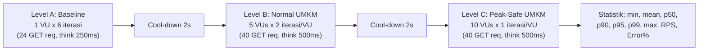

# Test Model Specification & Coverage Items — Performance Testing (`TD1` & `TD2`)

Dokumen ini mengimplementasikan aktivitas **`TD1` (*Create test model*)** dan **`TD2` (*Identify test coverage items*)** sesuai standar **`>= 2022`** (**ISO/IEC/IEEE 29119-1:2022**, **29119-5:2024**, & **ISO/IEC 25010:2023**) bersama **Sub-Plan [`TP-GOR-PERF-01`](./performance-test-plan.md)** untuk **Performance Testing** pada **Portal Booking GOR Permata Badminton Hall** (`https://gorpermatabadminton.com`).

---

## 0. Ringkasan Dokumen & Cara Pakai Script

- **Dokumen ini isinya apa?** Ini adalah **"Cetakan Rancangan Uji Kecepatan Website"**: menjelaskan apa saja yang diukur (kecepatan muncul halaman di laptop & HP, perbedaan saat cache masih kosong vs sudah tersimpan, berat file halaman, kecepatan respons klik tombol, serta simulasi `1`, `5`, dan `10` pengunjung bersamaan).
- **Apakah ada script yang harus di-copy-paste?** Dokumen ini hanya rancangan model uji (tidak dijalankan di Terminal). Untuk menjalankan tes kecepatannya di komputer, buka **Terminal / CMD / PowerShell** dari folder utama `tugas-qa-testing`, lalu **copy-paste perintah berikut ke Terminal**:
  ```bash
  python 03-hasil-pengujian/automation-scripts/test_performance_gor_permata.py
  ```

---

## 1. Inventarisasi *Test Basis* Performance (`TB-PERF` — `8.2.4.2 a`)

| ID Test Basis | Dimensi ISO/IEC 25010:2023 | Deskripsi Persyaratan Performa |
| :--- | :--- | :--- |
| **`TB-PERF-01`** | *Time Behaviour* (Frontend Web Vitals) | Halaman publik (`/`, `/booking`, `/login`, `/fasilitas/lapangan`) harus merespons cepat pada akses awal (*Cold Cache*) di *Desktop* dan *Mobile* sesuai ambang batas `TTFB`, `FCP`, `LCP`, `DCL`, `Load`, dan `CLS` pada `TP-GOR-PERF-01`. |
| **`TB-PERF-02`** | *Resource Utilization* (Payload & Caching) | Ukuran transfer dokumen HTML, rasio kompresi (`br`/`gzip`), jumlah permintaan aset eksternal, dan perilaku *Warm Cache* harus efisien tanpa membebani jaringan pengguna seluler. |
| **`TB-PERF-03`** | *Time Behaviour* (Interaksi Sisi Klien) | Aksi JS klien pada `/booking` (`openBooking()`, `updateTotal()`, `changeDate()`) harus merespons secara instan tanpa *UI freeze*. |
| **`TB-PERF-04`** | *Capacity & Reliability Under Load* | Server/CDN (`hcdn`) harus mempertahankan latensi `p95` stabil dan `Error Rate = 0%` di bawah akses konkuren aman skala UMKM (`1`, `5`, dan `10 VUs` `GET`-only). |

---

## 2. *Test Model Specification* (`TD1` — `TM-PERF-01` s.d. `TM-PERF-03`)

### 2.1 `TM-PERF-01`: *Browser Rendering, Core Web Vitals & Caching Model*

Model pengujian berbasis browser Chromium headless (`Playwright`) yang memisahkan tiga faktor pengujian:
- **Faktor Rute:** `/` (Beranda), `/booking?start_date=<besok>` (Grid Jadwal Berat), `/login` (Form Ringan), `/fasilitas/lapangan` (Konten Statis).
- **Faktor Cache State:** `Cold Cache` (BrowserContext baru) vs `Warm Cache` (navigasi ulang di halaman/konteks yang sama).
- **Faktor Perangkat / Viewport:** `Desktop (1280×800)` vs `Mobile (390×844)`.

Metrik yang diambil dari `window.performance`:
$$\text{TTFB} = \text{responseStart} - \text{requestStart}, \quad \text{DCL} = \text{domContentLoadedEventEnd} - \text{startTime}, \quad \text{Load} = \text{loadEventEnd} - \text{startTime}$$
serta metrik *Paint & Layout* (`FCP`, `LCP`, `CLS`) dan agregasi `PerformanceResourceTiming` (`encodedBodySize`, `decodedBodySize`, `transferSize`, jumlah aset CSS/JS/Image/Font).

---

### 2.2 `TM-PERF-02`: *Client-Side DOM Interaction Latency Model*

Model interaksi di halaman `/booking?start_date=<besok>` mengukur durasi *wall-clock* sisi browser:
1. **`openBooking()` Latency:** Klik tombol slot kosong pertama -> `#bookingModal` tampil (`display: flex`).
2. **`updateTotal()` Latency:** Perubahan nilai `#custDuration` (`1 -> 2 -> 3 -> 4 -> 5`) hingga `#dispTotal` selesai diperbarui.
3. **`changeDate()` Navigation Latency:** Memicu navigasi ke tanggal lusa (`today + 2`) hingga `DOMContentLoaded` selesai.

---

### 2.3 `TM-PERF-03`: *Tiered Non-Destructive Concurrent HTTP Workload Model*



Setiap *Virtual User (VU)* menjalankan siklus campuran rute tetap:
`GET /` -> `GET /booking?start_date=<besok>` -> `GET /login` -> `GET /fasilitas/lapangan`
dengan header `Accept-Encoding: gzip, br` untuk mencerminkan perilaku peramban modern, serta *auto-abort circuit breaker* apabila error > `5%`.

---

## 3. Identifikasi *Test Coverage Items* (`TD2` — `TCI-PERF-01` s.d. `TCI-PERF-10`)

| ID TCI | Sumber Model | Test Basis | Deskripsi *Coverage Item* | Prioritas Risiko | Target *Test Case* |
| :--- | :--- | :--- | :--- | :---: | :--- |
| `TCI-PERF-01` | `TM-PERF-01` | `TB-PERF-01` | Web Vitals *Cold Cache Desktop* pada rute `/` | Tinggi | `TC-PERF-01` |
| `TCI-PERF-02` | `TM-PERF-01` | `TB-PERF-01` | Web Vitals *Cold Cache Desktop* pada rute `/booking` | Tinggi | `TC-PERF-02` |
| `TCI-PERF-03` | `TM-PERF-01` | `TB-PERF-01` | Web Vitals *Cold Cache Desktop* pada `/login` & `/fasilitas/lapangan` | Sedang | `TC-PERF-03` |
| `TCI-PERF-04` | `TM-PERF-01` | `TB-PERF-02` | Komparasi *Cold vs Warm Cache* pada `/` & `/booking` | Sedang | `TC-PERF-04` |
| `TCI-PERF-05` | `TM-PERF-01` | `TB-PERF-01` | Web Vitals *Cold Cache Mobile* (`390×844`) pada `/` & `/booking` | Tinggi | `TC-PERF-05` |
| `TCI-PERF-06` | `TM-PERF-01` | `TB-PERF-02` | Profil ukuran payload (`HTML raw vs Brotli/Gzip`) & jumlah request aset | Tinggi | `TC-PERF-06` |
| `TCI-PERF-07` | `TM-PERF-02` | `TB-PERF-03` | Latensi interaksi DOM sisi klien (`openBooking`, `updateTotal`, `changeDate`) | Sedang | `TC-PERF-07` |
| `TCI-PERF-08` | `TM-PERF-03` | `TB-PERF-04` | Workload HTTP Level A (`1 VU` Baseline) — distribusi latensi & 0% error | Tinggi | `TC-PERF-08` |
| `TCI-PERF-09` | `TM-PERF-03` | `TB-PERF-04` | Workload HTTP Level B (`5 VUs` Normal UMKM) — `p95`, throughput, & 0% error | Tinggi | `TC-PERF-09` |
| `TCI-PERF-10` | `TM-PERF-03` | `TB-PERF-04` | Workload HTTP Level C (`10 VUs` Peak-Safe UMKM) — stabilitas & degradasi | Tinggi | `TC-PERF-10` |

> **Target Cakupan (`Completion Criterion`):** `100%` (`10 / 10` item `TCI-PERF-*`) wajib dieksekusi pada [`../03-hasil-pengujian/test-case-performance.md`](../03-hasil-pengujian/test-case-performance.md) melalui [`../03-hasil-pengujian/automation-scripts/test_performance_gor_permata.py`](../03-hasil-pengujian/automation-scripts/test_performance_gor_permata.py).
