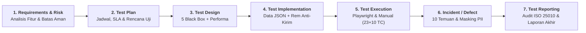

# Master Test Plan: Portal Booking GOR Permata Badminton Hall

Dokumen ini merupakan **Master Test Plan (`TP-GOR-01`)** yang disusun mematuhi standar resmi minimal tahun **`2022`**: **ISO/IEC/IEEE 29119-1:2022** (*General Concepts*), **ISO/IEC/IEEE 29119-5:2024** (*Keyword-Driven Testing*), **ISTQB CTFL Syllabus v4.0.1 (`2024`)** ([`ISTQB_CTFL_Syllabus_v4.0.1_2024.pdf`](../01-standar-ieee-iso/pdf-standar/ISTQB_CTFL_Syllabus_v4.0.1_2024.pdf)), **ISO/IEC 25010:2023**, **25019:2023**, **25002:2024**, dan **40500:2025 / W3C WCAG 2.2** (katalog lengkap: [`Referensi-Standar-ISO-Testing-dan-Kualitas-2022-2025.pdf`](../01-standar-ieee-iso/pdf-standar/Referensi-Standar-ISO-Testing-dan-Kualitas-2022-2025.pdf)).

---

## 1. Identifikasi Dokumen, Konteks, & Ruang Lingkup (`TP1 — Understand Context`)

### 1.1 Identifikasi Dokumen & Test Item
- **ID Master Test Plan:** `TP-GOR-01` (Versi `2.1` — Final Revisi Dosen)
- **Sub-Plan Terkait:** `TP-GOR-PERF-01` ([`performance-test-plan.md`](./performance-test-plan.md))
- **Klaim Kepatuhan:** *Tailored Conformance* terhadap arsitektur proses uji **ISO/IEC/IEEE 29119-1:2022** & **ISTQB CTFL v4.0.1** (lihat [`../01-standar-ieee-iso/organizational-test-specification.md`](../01-standar-ieee-iso/organizational-test-specification.md))
- **Sistem yang Diuji (*Test Item / SUT*):** Portal Web Publik **GOR Permata Badminton Hall** (`https://gorpermatabadminton.com`)
- **Lokasi UMKM:** Kp. Cipari, Desa Ciakar, Kec. Panongan, Kab. Tangerang, Banten
- **Karakteristik Bisnis Teramati:** Portal reservasi 4 lapangan bulu tangkis dengan tarif `PRICE_PER_HOUR = 40000` (`Rp 40.000`/jam), slot operasional `07:00–23:00` (tutup `00:00`), dan konfirmasi WhatsApp admin.

### 1.2 Pemangku Kepentingan (*Stakeholders*) & Rencana Komunikasi (`7.2.4.2 b, d`)
| Peran Pemangku Kepentingan | Nama / Pihak | Kepentingan & Tanggung Jawab | Kanal & Frekuensi Komunikasi |
| :--- | :--- | :--- | :--- |
| **Dosen Pengampu (Reviewer Akademik)** | Asep Erlan Maulana, S.Kom., M.Kom | Asesmen kelengkapan standar IEEE/ISO, sitasi SINTA 1–3, & kesiapan hasil uji sebelum wawancara | Presentasi kelas mingguan & repositori GitHub *Public* |
| **Anggota Kelompok** | • Muhammad Faiz Rabbani (`231011402539` — Tester / Eksekusi Pengujian) • Robi Farhan Anshori (`231011401468` — Dokumentasi & Laporan) • Dzikri Attariq Samayaki (`221011401148` — Perancangan Kasus Uji) • Nurlaelasari (`231011403531` — Analisis Kebutuhan & Sistem) | Perancangan strategi, penyusunan *Test Plan*, permodelan kasus uji, eksekusi otomasi/manual, reviu temuan, dan dokumentasi penutupan laporan | Commit & kolaborasi GitHub pada `tugas-qa-testing` |
| **Pemilik / Pengelola UMKM** | Pengelola GOR Permata Badminton Hall | Terlindungi agar data pemesanan fiktif uji tidak tersimpan ke jadwal asli maupun membebani server | Pengisian data uji fiktif dicegat di browser (*0 masuk server/WA pemilik*) |

### 1.3 Inventarisasi *Test Basis* (`7.2.4.2 c`)
1. **Perilaku Antarmuka & Fungsional Web Publik (`TB-BB-01..07`):** Halaman beranda (`/`), grid jadwal `/booking` beserta parameter `?start_date=`, modul modal `#bookingModal`, form `/login`, tautan `/register`, halaman `/fasilitas/*`, serta kompatibilitas viewport *Desktop* vs *Mobile*.
2. **Kode JavaScript Klien Publik `/booking` (`7.473` karakter):** Fungsi `rupiah()`, `changeDate()`, `updateTotal()`, `openBooking()`, `closeModal()`, `submitBooking()`, `normPhone()`, `manageBooking()` (`TB-WB` & `TB-BB`).
3. **Standar Kualitas Produk ISO/IEC 25010:2023 (`TB-PERF-01..04`):** Karakteristik *Functional Suitability*, *Performance Efficiency*, *Compatibility*, *Interaction Capability*, *Security*, dan *Safety* (batas jam tutup `00:00`).
4. **Pedoman Perkuliahan & Jurnal SINTA 1–3:** Modul Pertemuan 1–7 ([`00-materi-perkuliahan/`](../00-materi-perkuliahan/README.md)) dan 9 rujukan jurnal terakreditasi ([`referensi-sinta-1-3.md`](./referensi-sinta-1-3.md)).

### 1.4 Ruang Lingkup (*In Scope vs Out of Scope*)
- **In Scope:**
  1. **Black Box Testing (Fungsional & Interaksi):** Navigasi rute publik, parameter `?start_date=`, pembukaan/penutupan `#bookingModal`, kalkulasi tarif `updateTotal()`, validasi negatif dan nilai batas `#custName`, `#custPhone`, `#custDuration`, validasi klien `/login`, serta responsivitas *Desktop* (`1280×800`) dan *Mobile* (`390×844`).
  2. **Performance Testing (Non-Destruktif):** Profiling *Navigation Timing / Core Web Vitals* (`TTFB`, `DCL`, `Load`, `FCP`, `LCP`, `CLS`), analisis bobot payload HTML/aset (`Cold` vs `Warm`), *client interaction latency*, dan *concurrent HTTP GET benchmark* (`1`, `5`, `10 VUs`) pada [`performance-test-plan.md`](./performance-test-plan.md).
  3. **Catatan Pendukung Inspeksi Halaman Publik (Bukan Pengujian Utama Terpisah):** Pembacaan kode JS klien `/booking` (`normPhone()` & `submitBooking()`), atribut DOM, token CSRF, dan *HTTP Security Headers* guna menjelaskan akar bug yang ditangkap *Black Box*.
- **Out of Scope (*Tailored Exclusion*):**
  1. Penyimpanan transaksi ke basis data UMKM (`POST /bookings/store`) — formulir tetap diuji menggunakan **data pemesanan fiktif**, lalu pengiriman ke server dicegat di browser via `page.route` / `cy.intercept` agar `0` data tersimpan.
  2. Pengujian fitur internal admin/penjaga (`/bookings/confirm/*`, `/bookings/reject/*`, `/bookings/delete/*`) karena tidak memiliki kredensial resmi.
  3. Uji beban destruktif (*DDoS / High-Load Stress* > 10 VUs) serta eksploitasi keamanan aktif (*SQLi / Brute Force*).

---

## 2. Pengorganisasian Penyusunan Test Plan (`TP2 — Organize Test Plan Development`)

| Tahap Penyusunan | Aktivitas | Penanggung Jawab | Target Selesai |
| :---: | :--- | :--- | :---: |
| 1 | Pengumpulan konteks UMKM, standar resmi `>= 2022` (`ISO 29119-1/5`, `25010:2023`, `ISTQB v4.0.1`), & rujukan SINTA 2–3 (`2022–2026`) | Tim QA | 14–22 Nov 2026 |
| 2 | Identifikasi *Test Basis*, analisis risiko Project/Product, & rancangan *Test Strategy* | Tim QA | 17 Nov 2026 |
| 3 | Penyusunan *Sub-Plan Performance* & *Test Models* (Black Box + Performance) | Tim QA | 17 Nov 2026 |
| 4 | Reviu, kelengkapan anggota, & sinkronisasi repositori oleh seluruh tim | Tim QA | 17–18 Nov 2026 |

---

## 3. Identifikasi, Klasifikasi, & Perlakuan Risiko (`TP3` & `TP4`)

Sesuai prinsip *Risk-Based Testing* (**ISO/IEC/IEEE 29119-1:2022** & **ISTQB CTFL v4.0.1**), daftar risiko wajib membedakan **Project Risks** dan **Product Risks**, menetapkan tingkat *Exposure* (*Likelihood × Impact*), serta mendokumentasikan **Risk Treatment Approaches**:

### 3.1 Product Risks (Risiko Kualitas Produk)
| ID Risiko | Deskripsi Risiko Produk | Likelihood | Impact | Risk Exposure | Risk Treatment (`TP4`) |
| :--- | :--- | :---: | :---: | :---: | :--- |
| **`PR-01`** | Validasi nomor WhatsApp `normPhone()` gagal menangani format `+62 08...` atau digit batas (10/11/14/15 digit) sehingga pelanggan sah tertolak atau nomor salah lolos | Tinggi (3) | Tinggi (3) | **9 (Tinggi)** | **Mitigasi via Pengujian:** Terapkan *EP/BVA* lengkap pada `#custPhone` (`TM-BB-01`) + verifikasi *Basis Path* $V(G)=4$ dan catat di `Incident Report`. |
| **`PR-02`** | Parameter `?start_date=` menerima format rusak (picu `HTTP 500`) atau tanggal lampau yang masih merender tombol booking aktif | Tinggi (3) | Tinggi (3) | **9 (Tinggi)** | **Mitigasi via Pengujian:** Uji *EP/BVA* parameter `?start_date=` (hari ini, besok, tanggal lampau `2020-01-01`, string invalid) dan laporkan sebagai insiden prioritas tinggi. |
| **`PR-03`** | Ukuran HTML `/booking` besar (`~550 KB` un-compressed) dan *inline script* tunggal berpotensi memperlambat *TTFB / LCP* atau memicu *bottleneck* saat diakses beberapa pengguna serentak | Sedang (2) | Tinggi (3) | **6 (Sedang-Tinggi)** | **Mitigasi via Pengujian:** Jalankan *Performance Test Plan* (`TP-GOR-PERF-01`) mengukur *Web Vitals* (*Cold/Warm*, *Desktop/Mobile*) dan benchmark `1/5/10 VUs`. |
| **`PR-04`** | Input `#custName` tanpa `.trim()` / batas minimal memungkinkan nama kosong spasi lolos di sisi klien | Tinggi (3) | Sedang (2) | **6 (Sedang)** | **Mitigasi via Pengujian:** Uji *BVA* `#custName` (`""`, `"   "`, `"A"`, string normal) pada `TC-BB-*` dan catat defect validasi. |
| **`PR-05`** | Tautan `/register` mengembalikan `404` serta data slot DOM (`data-name`, `data-phone`) dan fungsi admin `manageBooking()` terpapar ke publik | Tinggi (3) | Sedang (2) | **6 (Sedang)** | **Mitigasi via Pengujian:** Verifikasi rute publik (`TC-BB-01..02`), audit *HTTP Security Headers* & atribut DOM pasif, lalu catat di `Incident Report` & audit `ISO 25010`. |
| **`PR-06`** | Kesalahan kalkulasi tarif `updateTotal()` atau gagal penolakan batas tutup `00:00` (`startHour + duration > 24`) | Rendah (1) | Tinggi (3) | **3 (Rendah-Sedang)** | **Mitigasi via Pengujian:** Uji *BVA* durasi `1..5` jam pada slot `21:00`, `22:00`, dan `23:00` melalui Playwright/Cypress dengan blocker `POST`. |

### 3.2 Project Risks (Risiko Pelaksanaan Proyek Uji)
| ID Risiko | Deskripsi Risiko Proyek | Likelihood | Impact | Risk Exposure | Risk Treatment (`TP4`) |
| :--- | :--- | :---: | :---: | :---: | :--- |
| **`PJ-01`** | Pengujian berulang menyentuh database jadwal produksi dan mengunci slot nyata UMKM | Sedang (2) | Kritis (4) | **8 (Tinggi)** | **Avoidance:** Formulir diuji memakai data uji fiktif non-PII, namun interceptor `page.route('**/bookings/store')` wajib mencegat pengiriman di browser sehingga `network_posts_sent_to_server == 0` terverifikasi di log. |
| **`PJ-02`** | Uji performa konkuren membebani server/CDN UMKM (`hcdn`) selama jam operasional | Sedang (2) | Tinggi (3) | **6 (Sedang-Tinggi)** | **Mitigasi & Pembatasan:** Batasi maksimum `10 VUs` (`GET`-only), jeda *think-time* `500 ms`, serta pasang *auto-abort circuit breaker* bila error rate > 5%. |
| **`PJ-03`** | Slot jadwal live pada portal target berubah setiap hari mengikuti tanggal berjalan | Sedang (2) | Rendah (1) | **2 (Rendah)** | **Optimasi:** Gunakan tanggal dinamis (`tomorrow`) & pemilih slot kosong dinamis pada skrip otomasi; seluruh data keempat anggota kelompok sudah lengkap terdokumentasi. |
| **`PJ-04`** | Perangkat lokal tidak memasang *runner* Cypress CLI penuh (hanya Python Playwright) | Sedang (2) | Rendah (1) | **2 (Rendah)** | **Retensi & Alternatif:** Eksekusi utama dijalankan melalui **Playwright Python** & `aiohttp`; skrip Cypress ([`gor-permata.cy.js`](../03-hasil-pengujian/automation-scripts/gor-permata.cy.js)) disinkronkan sebagai artefak kode modular dan perbedaan lingkungan dicatat pada `8.3.4.2 c`. |

---

## 4. Test Strategy (`TP5 — Design Test Strategy`, Flow Testing, & Justifikasi Black Box)

### 4.0 Flow Testing *End-to-End* (7 Tahap Pengujian Terurut dari Awal sampai Dokumentasi)

Seluruh pelaksanaan QA pada Portal Booking GOR Permata mengikuti alur berurutan 7 tahap yang mengintegrasikan **Materi Perkuliahan Testing dan QA (Pertemuan 1–7)** dengan arsitektur standar internasional **ISO/IEC/IEEE 29119-1:2022**, **29119-5:2024**, **ISO/IEC 25010:2023**, dan **ISTQB CTFL v4.0.1 (2024)** agar setiap temuan bug tertelusur dari standar hingga dokumentasi laporan resmi (*reproducible* dan nol dampak ke transaksi UMKM):

*(Diagram visual versi laporan formal tersedia pada [`00_flow_testing_gor_permata.png`](../03-hasil-pengujian/evidence/screenshots/00_flow_testing_gor_permata.png) dan Bab II Laporan Resmi di [`05-dokumentasi-laporan/`](../05-dokumentasi-laporan/).)*

#### Matriks Integrasi Flow Testing: Tahapan STLC, Materi Perkuliahan, & Standar ISO/IEEE/ISTQB

| No | Tahapan STLC | Rujukan Modul Kuliah | Klausul ISO / ISTQB (`>= 2022`) | Penjelasan Pelaksanaan pada Objek GOR Permata | Hasil / Berkas Keluaran |
| :-: | :--- | :--- | :--- | :--- | :--- |
| 1 | **Requirements & Risk Analysis** | **P1** (Konsep QA & ISO 9000), **P2** (Faktor Kualitas), **P3** (Misi Tim, Psikologi, & *Risk-Based Testing*) | `ISO/IEC/IEEE 29119-1:2022` Clause 6 (`OT1–OT3`) | Menentukan batasan izin akses (hanya halaman publik; dilarang kirim order fiktif ke database produksi), menghitung eksposur risiko produk (`PR-01..06`) dan risiko proyek (`PJ-01..04`). | [`organizational-test-specification.md`](../01-standar-ieee-iso/organizational-test-specification.md) |
| 2 | **Test Planning** | **P1–P3** (Obyektifitas Pengujian & Sasaran Mutu) | `ISO/IEC/IEEE 29119-1:2022` Clause 7.2 (`TP1–TP9`), `ISTQB CTFL v4.0.1` §1.4.1 | Menyusun *Master Test Plan* (`TP-GOR-01`) dan rencana uji beban kecepatan (`TP-GOR-PERF-01`), menetapkan jadwal, *Exit Criteria*, batas SLA kenyamanan, serta dasar ilmiah dari **9 jurnal SINTA 2–3 (`2022–2026`)**. | [`test-plan-gor-permata.md`](./test-plan-gor-permata.md), [`performance-test-plan.md`](./performance-test-plan.md), [`referensi-sinta-1-3.md`](./referensi-sinta-1-3.md) |
| 3 | **Test Design** | **P4–P5** (Struktur Logika/CFG pendukung), **P6** (Black Box: *EP, BVA*), **P7** (*Decision Table, STT, Use Case*) | `ISO/IEC/IEEE 29119-1:2022` Clause 8.2 (`TD1–TD4`), `ISTQB CTFL v4.0.1` Bab 4.2 | Memodelkan **5 teknik Black Box** (*Equivalence Partitioning, Boundary Value Analysis, Decision Table, State Transition, Use Case & Mobile*) dan model beban *Workload 1/5/10 VUs* secara tertelusur (`TB -> TM -> TCI -> TC -> PROC`). | [`test-model-blackbox.md`](./test-model-blackbox.md), [`test-model-performance.md`](./test-model-performance.md), [`analisis-white-black-gray-box.md`](./analisis-white-black-gray-box.md), [`test-case-blackbox.md`](../03-hasil-pengujian/test-case-blackbox.md), [`test-case-performance.md`](../03-hasil-pengujian/test-case-performance.md) |
| 4 | **Test Implementation & Environment** | Modul Lanjutan (*Automation Testing*) & Pemisahan Data Uji | `ISO/IEC/IEEE 29119-1:2022` Clause 8.3 (`ED1–ED4`), `ISO/IEC/IEEE 29119-5:2024` (*Keyword-Driven*) | Menyiapkan dataset uji fiktif format JSON; memasang **rem pemblokir browser (`page.route`)** agar pengiriman form tidak masuk basis data nyata UMKM (`network_posts_sent_to_server == 0`), serta *circuit breaker* performa. | [`test-environment-dan-data.md`](../03-hasil-pengujian/test-environment-dan-data.md), [`blackbox-testdata.json`](../03-hasil-pengujian/test-data/blackbox-testdata.json), [`performance-profiles.json`](../03-hasil-pengujian/test-data/performance-profiles.json) |
| 5 | **Test Execution** | Modul Lanjutan (*Eksekusi Otomasi Playwright & aiohttp*) | `ISO/IEC/IEEE 29119-1:2022` Clause 8.4 (`TE1–TE3`) | Mengeksekusi `23` skenario uji fungsi Black Box (`16 PASS, 7 FAIL`) dan `10` skenario kecepatan (`104` akses baca halaman, `0%` error) di layar laptop & HP, sekaligus pengecekan silang manual. | [`test-execution-log.md`](../03-hasil-pengujian/test-execution-log.md), log mentah & [`evidence/`](../03-hasil-pengujian/evidence/) |
| 6 | **Incident / Defect Reporting** | **P3** (Psikologi Pengujian & Siklus Hidup Cacat) | `ISO/IEC/IEEE 29119-1:2022` Clause 8.5 (`IR1–IR2`), `ISTQB CTFL v4.0.1` Bab 5.5 | Mendokumentasikan `10` temuan masalah ([`incident-reports.md`](../03-hasil-pengujian/incident-reports.md)) dengan format lengkap (*Severity, Priority, Steps to Reproduce, Saran Perbaikan*), sambil menyamarkan nama pemesan lain di screenshot menjadi `[TERISI]`. | [`incident-reports.md`](../03-hasil-pengujian/incident-reports.md), [`evidence/screenshots/`](../03-hasil-pengujian/evidence/screenshots/) |
| 7 | **Test Reporting & Completion** | **P1–P2** (Model Kualitas Perangkat Lunak) & Penutupan Uji | `ISO/IEC/IEEE 29119-1:2022` Clause 7.3 & 7.4 (`TC1–TC4`), `ISO/IEC 25010:2023`, `ISO 25019:2023` | Memastikan semua target selesai 100%, mengaudit kualitas produk berbasis 9 dimensi **ISO 25010:2023**, membersihkan environment, mengarsipkan kode uji di Git, dan menyusun laporan akhir Word & PDF. | [`test-status-and-control-report.md`](../03-hasil-pengujian/test-status-and-control-report.md), [`test-completion-report.md`](../03-hasil-pengujian/test-completion-report.md), [`evaluasi-iso-25010-gor-permata.md`](../01-standar-ieee-iso/evaluasi-iso-25010-gor-permata.md), [`05-dokumentasi-laporan/`](../05-dokumentasi-laporan/) |

*(Alur Balik Otomatis: kalau di Tahap 5–6 ketemu masalah baru yang belum ada di rencana awal—seperti menu HP terpotong—tim kembali sebentar ke Tahap 3 untuk menambahkan skenario tersebut agar ikut teruji dan tercatat resmi.)*

### 4.1 Pendekatan & Teknik Pengujian (`ISTQB CTFL v4.0.1` & `ISO/IEC/IEEE 29119-1:2022`)
1. **Black Box Testing — 5 Jenis Teknik yang Dipilih & Alasannya** *(penjelasan sederhana perbandingan teknik ada pada [`test-model-blackbox.md`](./test-model-blackbox.md#15-mengapa-memilih-5-jenis-teknik-black-box-ini-penjelasan-sederhana))*
   - **Equivalence Partitioning (EP):** Dipilih untuk memecah domain input tak terbatas pada `#custName`, `#custPhone`, `?start_date=`, dan `/login` menjadi kelas partisi valid/tidak valid yang efisien (*Desyani, dkk., 2022*).
   - **Boundary Value Analysis (BVA):** Dipilih karena mayoritas bug portal reservasi terjadi tepat di nilai batas tepi: panjang WA `/^628\d{8,11}$/` (`10, 11, 14, 15` digit), nama (`0, 1, 3` spasi), durasi `1..5` jam, dan batas operasional tutup `00:00` (*Putri & Susanto, 2024*).
   - **Decision Table Testing:** Dipilih untuk memetakan 4 syarat aturan validasi `submitBooking()` ke 6 kombinasi aksi keputusan secara deterministik tanpa aturan yang terlewat (*Sitio, dkk., 2023*).
   - **State Transition Testing (STT):** Dipilih karena perilaku utama aplikasi adalah transisi status UI: grid -> modal open -> validasi alert / blocked fetch -> reset `closeModal()` serta klik slot `RTBC` -> dialog konfirmasi (*ISTQB v4.0.1 Bab 4.2.4*).
   - **Use Case & Compatibility Testing (`ISO/IEC 40500:2025 / WCAG 2.2`):** Dipilih untuk menguji alur penuh pengunjung di *Desktop* (`1280×800`) dan *Mobile* (`390×844`) sekaligus pemeriksaan eksposur privasi DOM publik (*Fhonna, dkk., 2026; Seputra, dkk., 2024*).
   - *Rujukan Ilmiah (`>= 2022`):* **Desyani, dkk. (2022)** (*JTSI*), **Sitio, dkk. (2023)** (*JIUP*), **Putri & Susanto (2024)** (*Sinkron*), **Seputra, dkk. (2024)** (*RESTI*), dan **Fhonna, dkk. (2026)** (*Sisfo*).
2. **Performance Testing (*Time Behaviour, Resource Utilization, Safe Capacity*):**
   - Dirinci lengkap pada [`performance-test-plan.md`](./performance-test-plan.md) (`TP-GOR-PERF-01`).
   - Mengukur *Navigation Timing / Web Vitals* (`TTFB`, `DCL`, `Load`, `FCP`, `LCP`, `CLS`, *payload bytes*) serta uji beban HTTP `GET` bertingkat (`1`, `5`, `10 VUs`).
   - *Rujukan Ilmiah SINTA 2–3 (`>= 2022`):* **Winasis, dkk. (2026)** (*Sinkron, SINTA 3*) untuk uji beban bertingkat sistem booking/komplain + WhatsApp Laravel, **Zahra & Kraugusteeliana (2023)** (*JTIIK, SINTA 2*) untuk dimensi *Performance Efficiency* ISO 25010, dan **Putra, dkk. (2026)** (*JAIC, SINTA 3*) untuk keunggulan otomasi **Playwright** dibanding Cypress/Selenium.
   - **Catatan Pendukung Baca Kode Tampilan (Opsional):** Ringkasan alur kode JS halaman `/booking` pada [`analisis-white-black-gray-box.md`](./analisis-white-black-gray-box.md) (*Nada, dkk., 2023; Alirridlo, dkk., 2025*) hanya dipakai untuk memahami penyebab error `normPhone()` di balik layar.

### 4.2 Metrik Pemantauan & Pengendalian (`7.2.4.6 c` -> `TMC1–TMC4`)
- **Black Box Coverage:** `% TCI-BB` yang tercakup & dieksekusi; rasio `PASS / FAIL / INCONCLUSIVE` per prioritas risiko.
- **Performance Metrics:** `TTFB`, `FCP`, `LCP`, `CLS`, `DOMContentLoaded`, `p50/p90/p95/p99 HTTP latency`, `RPS`, `Payload KB`, dan `HTTP Error Rate (%)`.
- **Safety Guardrail Metric:** Jumlah `POST /bookings/store` yang lolos ke jaringan (**wajib = `0`**).
- **Incident Density:** Jumlah `IR-GOR-*` berdasarkan kategori & *Severity*.

### 4.3 Kriteria Masuk, Penyelesaian, Penangguhan, & Kelanjutan (`7.2.4.6 a Note 2`)
- **Entry Criteria:**
  1. Target `https://gorpermatabadminton.com` aktif (`HTTP 200 OK`).
  2. *Test Environment* (`Python 3.9`, `Playwright`, `aiohttp`) & dataset JSON terverifikasi siap pada [`test-environment-dan-data.md`](../03-hasil-pengujian/test-environment-dan-data.md).
- **Test Completion / Exit Criteria:**
  1. **100%** `TCI-BB` dan `TCI-PERF` prioritas Tinggi & Sedang telah diturunkan menjadi `TC` dan dieksekusi.
  2. Seluruh skrip otomasi berjalan tanpa *unhandled exception* dengan `post_attempts == 0`.
  3. Seluruh deviasi hasil atau pelanggaran SLA tercatat resmi sebagai *Incident Report* pada [`incident-reports.md`](../03-hasil-pengujian/incident-reports.md).
  4. *Test Status Report*, *Test Completion Report*, dan pembaruan audit `ISO 25010:2023` telah selesai disusun.
- **Suspension Criteria (Kriteria Penangguhan Uji):**
  1. Target mengalami *downtime* berkepanjangan (`HTTP 502/503/504`) atau *rate-limiting* (`HTTP 429`) dengan rasio error > 5% selama *performance benchmark*.
  2. Interceptor `page.route` terdeteksi gagal memblokir request `POST`.
- **Resumption Criteria (Kriteria Melanjutkan Uji):**
  1. Layanan target kembali stabil (`HTTP 200 OK` pada pemeriksaan awal) setelah jeda pendinginan minimal 5 menit, atau *bug* pada guardrail skrip telah diperbaiki.

### 4.4 Kebutuhan Data, Lingkungan, & Deliverables (`7.2.4.6 d–f`)
- **Test Environment Requirements:** Browser headless Chromium (`Playwright`), runtime Python 3.9 (`aiohttp`), resolusi `1280×800` dan `390×844`, serta interceptor jaringan lokal.
- **Test Data Requirements:** Data sintetik non-PII untuk batas input Black Box ([`blackbox-testdata.json`](../03-hasil-pengujian/test-data/blackbox-testdata.json)) dan profil beban performa ([`performance-profiles.json`](../03-hasil-pengujian/test-data/performance-profiles.json)).
- **Test Deliverables:** Seluruh berkas pada folder `01`, `02`, dan `03` sesuai matriks kepatuhan pada [`standar-dokumentasi-qa.md`](../01-standar-ieee-iso/standar-dokumentasi-qa.md).

---

## 5. Staffing, Jadwal, & Estimasi Upaya (`TP6` & `TP7`)

| Peran | Penanggung Jawab | Fokus Tugas *(Selaras Pembagian Tim)* | Estimasi Upaya | Jadwal Pelaksanaan |
| :--- | :--- | :--- | :---: | :---: |
| **Tester / Eksekusi Pengujian** | Muhammad Faiz Rabbani (`231011402539`) | Eksekusi skrip Playwright & `aiohttp`, pengujian manual fungsional/performa, & verifikasi *guardrail* aman | ~4–5 jam | 14–23 Nov 2026 |
| **Dokumentasi & Penyusunan Laporan** | Robi Farhan Anshori (`231011401468`) | Pengadaan standar ISO/IEEE, perapihan dokumentasi & *Test Flow*, serta penyusunan laporan akhir | ~4–5 jam | 14–23 Nov 2026 |
| **Perancangan Kasus Uji (*Test Design*)** | Dzikri Attariq Samayaki (`221011401148`) | Pemodelan `5` teknik *Black Box* & profil beban performa, penurunan *Test Case*, & persiapan wawancara (`04/`) | ~4–5 jam | 14–23 Nov 2026 |
| **Analisis Kebutuhan & Hasil** | Nurlaelasari (`231011403531`) | Analisis kebutuhan objek UMKM, *Test Basis*, evaluasi temuan insiden, & persiapan wawancara (`04/`) | ~4–5 jam | 14–23 Nov 2026 |

---

## 6. Persetujuan & Distribusi Test Plan (`TP8` & `TP9`)

| Pemangku Kepentingan | Peran | Status Persetujuan | Tanggal |
| :--- | :--- | :---: | :---: |
| Muhammad Faiz Rabbani (`231011402539`) | Tester / Eksekusi Pengujian | **Disetujui & Sinkron Repo** | 18 Nov 2026 |
| Robi Farhan Anshori (`231011401468`) | Dokumentasi & Penyusunan Laporan | **Disetujui & Sinkron Repo** | 18 Nov 2026 |
| Dzikri Attariq Samayaki (`221011401148`) | Perancangan Kasus Uji (*Test Design*) | **Disetujui & Sinkron Repo** | 18 Nov 2026 |
| Nurlaelasari (`231011403531`) | Analisis Kebutuhan & Hasil (*Requirements & Analysis*) | **Disetujui & Sinkron Repo** | 18 Nov 2026 |
| Asep Erlan Maulana, S.Kom., M.Kom | Dosen Pengampu *(Reviewer Eksternal)* | *Menunggu Asesmen Kelas* | — |

Dokumen tersedia secara terbuka pada repositori publik `https://github.com/BrongSkuy/tugas-qa-testing` ([`test-plan-gor-permata.md`](./test-plan-gor-permata.md)).
