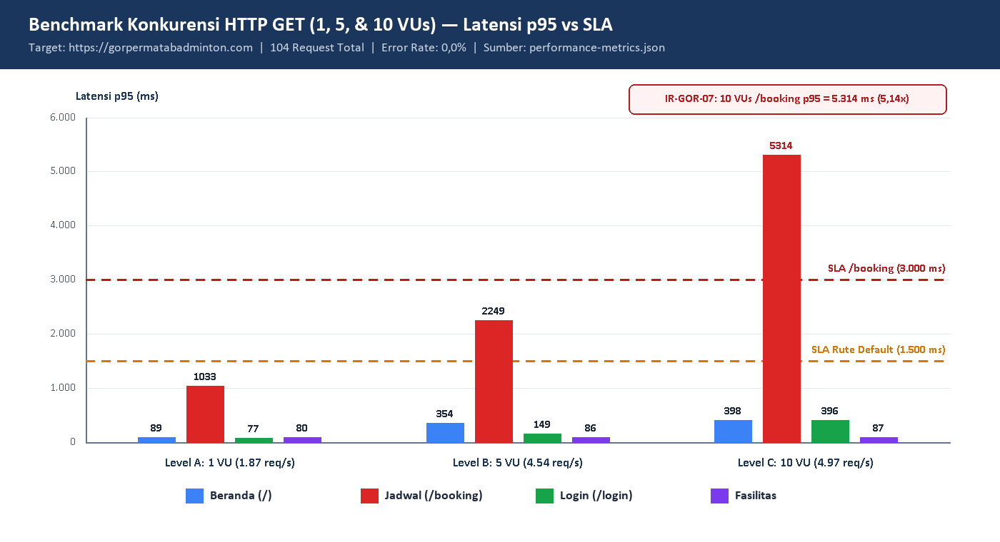

# Ringkasan Hasil Pengujian Performance (`TC-PERF-01` s.d. `TC-PERF-10`)

Dokumen ini merangkum hasil pengujian kecepatan halaman, respons klik tombol, ukuran dokumen, serta simulasi pengunjung bersamaan (**Performance Testing**) pada **Portal Booking GOR Permata Badminton Hall** (`https://gorpermatabadminton.com`) yang dijalankan melalui [`test_performance_gor_permata.py`](../automation-scripts/test_performance_gor_permata.py) pada `2026-11-17T22:05:00+07:00` (data mentah: [`performance-metrics.json`](./performance-metrics.json)).

---

## 1. Ringkasan Eksekutif

- **Total Skenario Dijalankan:** `10` kasus uji (`5` pengujian kecepatan tampilan browser Laptop & HP, `1` audit ukuran halaman, `1` uji respons klik tombol, dan `3` tingkat simulasi pengunjung bersamaan `1`, `5`, dan `10` orang).
- **Hasil Eksekusi:** **`7` Berhasil (`PASS`)** dan **`3` Bermasalah (`FAIL`)**, dengan **`0,0%` kegagalan server** dari total **`104` kali akses `GET`** (`circuit breaker` tidak pernah terpicu).
- **Yang Sudah Berjalan Baik (`7 Pass`):**
  - Respons klik tombol di halaman `/booking` sangat cepat: membuka pop-up booking hanya `62,93 ms` (`0,06` detik) dan hitung ulang harga rata-rata `8,11 ms` (jauh di bawah batas `250 ms`).
  - Saat halaman dibuka ulang dengan cache browser aktif, beranda `/` tampil sangat cepat dalam `289,3 ms` (`0,29` detik) tanpa aset gagal muat.
  - Akses awal `/login` (`0,69` detik), `/fasilitas/lapangan` (`0,71` detik), `/booking` (`1,83` detik), serta tampilan di layar HP (`390×844`) seluruhnya memenuhi batas target tanpa pergeseran tata letak (`CLS = 0`).
  - Pada simulasi `1` orang (`24` akses) dan `5` orang bersamaan (`40` akses), seluruh halaman merespons lancar di bawah batas target `3` detik (`0%` error).
- **3 Kendala yang Ditemukan (`3 Fail`):**
  1. **`IR-GOR-07` (`TC-PERF-10`):** Saat `10` orang membuka halaman secara bersamaan, waktu muat `/booking` melonjak hingga **`5,31 detik`** (`p95 = 5.314,28 ms`, melewati batas `3` detik), walaupun semua permintaan tetap berhasil (`0%` error).
  2. **`IR-GOR-08` (`TC-PERF-06`):** Ukuran file HTML mentah `/booking` sebelum dikompresi mencapai **`535,37 KB`** (`548.217` bytes, sedikit melewati batas `500 KB`) karena jadwal `7` hari dimuat sekaligus dalam satu dokumen.
  3. **`IR-GOR-09` (`TC-PERF-01`):** Saat beranda `/` pertama kali dibuka di laptop tanpa cache, respons awal server (`TTFB`) sempat melambat ke **`2,62 detik`** (`2.618,3 ms`, target `<= 0,8` detik) dengan tampilan awal (`FCP`) di `3,03` detik.

---

## 2. Tabel Hasil 10 Kasus Uji Performance

| ID Uji | Skenario Pengujian | Batas Target | Hasil Terukur | Status | Ref. Insiden |
| :--- | :--- | :--- | :--- | :---: | :---: |
| **`TC-PERF-01`** | Kecepatan buka pertama beranda `/` (Laptop) | Respon awal `<= 800 ms`, tampil `<= 3.000 ms` | Respon awal `2.618,3 ms`, tampil `3.028 ms`, selesai `3,34` detik | **FAIL** | `IR-GOR-09` |
| **`TC-PERF-02`** | Kecepatan buka pertama `/booking` (Laptop) | Respon awal `<= 1.800 ms`, tampil `<= 3.000 ms` | Respon awal `1.213 ms`, tampil `1.712 ms`, selesai `1,83` detik | **PASS** | — |
| **`TC-PERF-03`** | Kecepatan buka `/login` & `/fasilitas/lapangan` | Respon awal `<= 800 ms`, tampil `<= 3.000 ms` | `/login` (`98,9 ms`), `/fasilitas/lapangan` (`95,9 ms`) | **PASS** | — |
| **`TC-PERF-04`** | Perbandingan buka pertama vs buka ulang (cache aktif) | Buka ulang lebih cepat & `0` aset gagal | `/` turun `3,34 -> 0,29` detik; `/booking` turun `1,83 -> 1,16` detik | **PASS** | — |
| **`TC-PERF-05`** | Kecepatan buka `/` & `/booking` di layar HP (`390×844`) | `/` `<= 800 ms`, `/booking` `<= 1.800 ms`, `CLS <= 0,25` | `/` (`108,2 ms`), `/booking` (`1.016,5 ms`), `CLS = 0` | **PASS** | — |
| **`TC-PERF-06`** | Audit ukuran file HTML & kompresi `/booking` | HTML mentah `<= 500 KB`, `0` aset gagal | HTML mentah **`535,37 KB`** (terkompresi `34,78 KB`) | **FAIL** | `IR-GOR-08` |
| **`TC-PERF-07`** | Kecepatan respons klik tombol di `/booking` | Semua interaksi `<= 250 ms` | Buka modal `62,93 ms`, hitung tarif `8,11 ms`, ganti tanggal `3,03 ms` | **PASS** | — |
| **`TC-PERF-08`** | Simulasi `1` orang (`24` akses `GET`) | Error `0%`, `/booking` `p95 <= 3.000 ms` | Error `0,0%`, `/booking` `p95 = 1.033,24 ms` (`1,03` detik) | **PASS** | — |
| **`TC-PERF-09`** | Simulasi `5` orang bersamaan (`40` akses `GET`) | Error `0%`, `/booking` `p95 <= 3.000 ms` | Error `0,0%`, `/booking` `p95 = 2.249,31 ms` (`2,25` detik) | **PASS** | — |
| **`TC-PERF-10`** | Simulasi `10` orang bersamaan (`40` akses `GET`) | Error `0%`, `/booking` `p95 <= 3.000 ms` | Error `0,0%`, namun `/booking` **`p95 = 5.314,28 ms`** (`5,31` detik) | **FAIL** | `IR-GOR-07` |

---

## 3. Rincian Metrik Kecepatan Browser (Laptop vs HP)

### 3.1 Buka Pertama — Laptop (`1280×800`, *Cold Cache*)
| Rute | HTTP | Respon Awal (`TTFB`) | Siap DOM (`DCL`) | Selesai Muat (`Load`) | Tampil Awal (`FCP`) | Geser Layar (`CLS`) | Ukuran Asli | Ukuran Kompresi | Aset |
| :--- | :-: | :-: | :-: | :-: | :-: | :-: | :-: | :-: | :-: |
| `/` | `200` | **2.618,3 ms** | 3.031,1 ms | 3.343,4 ms | **3.028,0 ms** | `0,0` | 37,06 KB | 9,14 KB | 9 (`627,7 KB`) |
| `/booking?start_date=2026-11-18` | `200` | 1.213,0 ms | 1.722,2 ms | 1.826,2 ms | 1.712,0 ms | `0,0` | **535,37 KB** | 34,78 KB | 5 (`27,5 KB`) |
| `/login` | `200` | 98,9 ms | 551,8 ms | 689,8 ms | 572,0 ms | `0,0` | 12,85 KB | 4,39 KB | 5 (`27,5 KB`) |
| `/fasilitas/lapangan` | `200` | 95,9 ms | 595,8 ms | 708,0 ms | 620,0 ms | `0,0` | 9,20 KB | 3,06 KB | 8 (`627,7 KB`) |

> **Catatan `LCP`:** Pada mode browser otomatis *headless* (`chromium-headless-shell`) tanpa interaksi pengguna, entri `largest-contentful-paint` bernilai `null` (`N/A`), sehingga evaluasi kecepatan tampilan menggunakan `TTFB`, `FCP`, `DCL`, `Load`, dan `CLS` yang terukur langsung.

### 3.2 Buka Ulang (*Warm Cache* Laptop) & Layar HP (`390×844`)
| Kondisi / Perangkat | Rute | Respon Awal (`TTFB`) | Siap DOM (`DCL`) | Selesai Muat (`Load`) | Tampil Awal (`FCP`) | Transfer Aset |
| :--- | :--- | :-: | :-: | :-: | :-: | :-: |
| **Buka Ulang (Laptop)** | `/` | 89,4 ms | 172,2 ms | **289,3 ms** | 156,0 ms | `0 B` *(cache)* |
| **Buka Ulang (Laptop)** | `/booking?start_date=2026-11-18` | 963,1 ms | 1.155,1 ms | **1.155,2 ms** | 1.032,0 ms | `0 B` *(cache)* |
| **Buka Pertama (HP `390×844`)** | `/` | 108,2 ms | 710,5 ms | **802,2 ms** | 708,0 ms | `387,8 KB` |
| **Buka Pertama (HP `390×844`)** | `/booking?start_date=2026-11-18` | 1.016,5 ms | 1.591,5 ms | **1.687,5 ms** | 1.580,0 ms | `27,5 KB` |

### 3.3 Kecepatan Respons Klik Tombol di `/booking`
- **`openBooking()` (Klik slot -> pop-up tampil):** `62,93 ms` *(target `<= 250 ms` -> PASS)*
- **`updateTotal()` (Ubah durasi `2..5` jam):** Rata-rata `8,11 ms`, maksimum `13,94 ms` *(target `<= 250 ms` -> PASS)*
- **`changeDate()` (Ganti tanggal jadwal):** `3,03 ms` *(target `<= 250 ms` -> PASS)*

---

## 4. Simulasi Pengunjung Bersamaan (`1`, `5`, dan `10` Orang)

Total `104` permintaan baca halaman (`GET`) dijalankan secara bertingkat dengan hasil **`0,0%` error**:

| Tingkat Beban | Pengunjung (`VUs`) | Total Akses | Akses/Detik (`RPS`) | Error | `/` `p95` | `/booking` `p50` | `/booking` `p95` | `/booking` `max` | `/login` `p95` | `/fasilitas/lapangan` `p95` |
| :--- | :-: | :-: | :-: | :-: | :-: | :-: | :-: | :-: | :-: | :-: |
| **Level A: Baseline** | `1` | 24 | 1,87 | `0,0%` | 89,47 ms | 885,31 ms | 1.033,24 ms | 1.054,09 ms | 76,71 ms | 79,81 ms |
| **Level B: Normal** | `5` | 40 | 4,54 | `0,0%` | 353,52 ms | 1.949,95 ms | 2.249,31 ms | 2.278,17 ms | 148,63 ms | 86,27 ms |
| **Level C: Jam Ramai** | `10` | 40 | 4,97 | `0,0%` | 397,77 ms | 5.138,42 ms | **5.314,28 ms** | 5.323,45 ms | 396,28 ms | 87,18 ms |

### Analisis Penyebab Perlambatan
1. **Perlambatan `/booking` saat `10` orang bersamaan (`IR-GOR-07`):** Dari `1` ke `10` pengguna, waktu muat `/booking` naik `5,14x` (`1,03` detik -> `5,31` detik), sementara halaman lain tetap di bawah `0,4` detik. Penyebabnya adalah penyusunan tabel jadwal mingguan berukuran besar (`~548 KB` HTML mentah) yang terus dibuat ulang dari server tanpa cache (`Cache-Control: no-cache, private`).
2. **Ukuran HTML `/booking` (`IR-GOR-08`):** Seluruh jadwal `7` hari dimuat sekaligus dalam satu file HTML (`535,37 KB` sebelum kompresi), meski kompresi jaringan menekannya menjadi `34,78 KB`.
3. **Lonjakan awal beranda `/` (`IR-GOR-09`):** Akses pertama tanpa cache mencatat `2,62` detik sebelum turun drastis ke `89,4 ms` saat dibuka ulang, menandakan perlunya caching ringan di server/CDN.

---

## 5. Dokumen Pendukung & Laporan Lengkap

- **Spesifikasi Skenario Performa:** [`test-case-performance.md`](../test-case-performance.md)
- **Log Eksekusi & Data Mentah:** [`test-execution-log.md`](../test-execution-log.md) | [`performance-log.txt`](../automation-scripts/performance-log.txt) | [`performance-metrics.json`](./performance-metrics.json)
- **Rincian 10 Masalah & Saran Perbaikan:** [`incident-reports.md`](../incident-reports.md)
- **Laporan Resmi Lengkap (Word & PDF):** [`05-dokumentasi-laporan/`](../../05-dokumentasi-laporan/)
