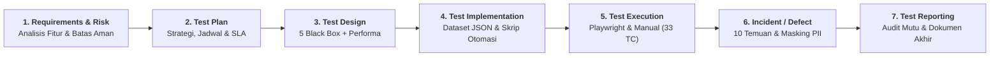

# Dokumentasi Pengujian & Quality Assurance Perangkat Lunak

Repositori resmi dokumentasi pengujian perangkat lunak untuk pemenuhan tugas kelompok mata kuliah **Testing dan Quality Assurance (QA) Perangkat Lunak**, Program Studi Teknik Informatika (S1), Universitas Pamulang.

- **Dosen Pengampu:** Asep Erlan Maulana, S.Kom., M.Kom
- **Kelas / Shift:** 07TPLE001 / Reguler C
- **Repositori:** https://github.com/BrongSkuy/tugas-qa-testing
- **Standar Acuan (`>= 2022`):** ISO/IEC/IEEE 29119-1:2022, 29119-5:2024, ISO/IEC 25010:2023, ISO/IEC 25019:2023, ISO/IEC 40500:2025 (WCAG 2.2), dan ISTQB CTFL Syllabus v4.0.1 (2024).

---

## Anggota Kelompok

| No | Nama Lengkap | NIM | Peran / Pembagian Tugas | Akun GitHub |
| :---: | :--- | :---: | :--- | :--- |
| 1 | Muhammad Faiz Rabbani | 231011402539 | Tester / Eksekusi Pengujian | [@BrongSkuy](https://github.com/BrongSkuy) |
| 2 | Robi Farhan Anshori | 231011401468 | Dokumentasi & Penyusunan Laporan | [@robifr](https://github.com/robifr) |
| 3 | Dzikri Attariq Samayaki | 221011401148 | Perancangan Kasus Uji (*Test Design*) | [@meongasli](https://github.com/meongasli) |
| 4 | Nurlaelasari | 231011403531 | Analisis Kebutuhan & Hasil (*Requirements & Analysis*) | [@ela123-code](https://github.com/ela123-code) |

---

## Profil Objek & Ruang Lingkup Pengujian

- **Objek Uji:** **Portal Booking GOR Permata Badminton Hall** ([gorpermatabadminton.com](https://gorpermatabadminton.com))
- **Lokasi UMKM:** Kp. Cipari, Desa Ciakar, Kec. Panongan, Kab. Tangerang, Banten
- **Fokus Pengujian:**
  1. **Black Box Testing (23 Kasus Uji):** Pengujian fungsionalitas antarmuka, validasi form reservasi, kalkulasi tarif, batas jam operasional, dan kompatibilitas tampilan lintas perangkat (*Desktop & Mobile*) menggunakan 5 teknik formal (*Equivalence Partitioning, Boundary Value Analysis, Decision Table, State Transition, Use Case*).
  2. **Performance Testing (10 Kasus Uji):** Pengukuran efisiensi waktu muat (*Core Web Vitals*), utilisasi payload HTML/aset, latensi interaksi DOM, serta simulasi beban bertingkat (*Tiered Concurrency 1, 5, dan 10 Virtual Users*).
- **Prinsip Non-Destruktif:** Pengujian dilakukan secara aman pada sistem produksi aktif tanpa mengubah data jadwal nyata UMKM melalui penerapan data uji sintetis dan pencegatan jaringan (*network route abort*) di sisi peramban.

---

## Alur Pengujian (Test Flow STLC)

Proses pengujian dijalankan terstruktur mengacu pada kerangka **Software Testing Life Cycle (STLC)** dan **Fundamental Test Process** (**ISO/IEC/IEEE 29119-1:2022** & **ISTQB CTFL v4.0.1**), yang diintegrasikan dengan materi perkuliahan:



| No | Tahapan STLC | Deskripsi Pelaksanaan | Acuan Standar & Perkuliahan | Dokumen Output |
| :-: | :--- | :--- | :--- | :--- |
| 1 | **Requirements & Risk Analysis** | Identifikasi kebutuhan fungsional dan penetapan mitigasi risiko non-destruktif bagi UMKM. | ISO 29119-1 Klausul 6 (`OT1–OT3`) & Kuliah P1–P3 | [`organizational-test-specification.md`](./01-standar-ieee-iso/organizational-test-specification.md) |
| 2 | **Test Planning** | Perumusan rencana uji induk, ambang batas SLA performa, jadwal kerja, dan kriteria kelulusan. | ISO 29119-1 Klausul 7.2 (`TP1–TP9`), ISTQB §1.4.1 | [`test-plan-gor-permata.md`](./02-objek-umkm-dan-rencana-uji/test-plan-gor-permata.md) |
| 3 | **Test Design** | Perancangan model uji dan spesifikasi kasus uji Black Box (5 teknik) serta profil beban kerja. | ISO 29119-1 Klausul 8.2 (`TD1–TD4`), ISTQB Bab 4.2 & Kuliah P6–P7 | [`test-model-blackbox.md`](./02-objek-umkm-dan-rencana-uji/test-model-blackbox.md), [`test-case-blackbox.md`](./03-hasil-pengujian/test-case-blackbox.md) |
| 4 | **Test Implementation** | Penyiapan lingkungan pengujian, dataset JSON terisolasi, dan guardrail pencegat request database. | ISO 29119-1 Klausul 8.3 (`ED1–ED4`), ISO 29119-5:2024 | [`test-environment-dan-data.md`](./03-hasil-pengujian/test-environment-dan-data.md), `test-data/` |
| 5 | **Test Execution** | Eksekusi otomatisasi peramban Chromium (Desktop/Mobile) serta benchmark latensi HTTP konkuren. | ISO 29119-1 Klausul 8.4 (`TE1–TE3`) & Modul Otomasi | [`test-execution-log.md`](./03-hasil-pengujian/test-execution-log.md), log mentah & JSON |
| 6 | **Incident / Defect Reporting** | Dokumentasi temuan insiden (*Severity/Priority*) dan penyensoran data pribadi (*PII masking*). | ISO 29119-1 Klausul 8.5 (`IR1–IR2`), ISTQB Bab 5.5 & Kuliah P3 | [`incident-reports.md`](./03-hasil-pengujian/incident-reports.md), `evidence/screenshots/` |
| 7 | **Test Reporting & Completion** | Evaluasi kriteria selesai, audit 9 dimensi mutu ISO 25010, dan penerbitan laporan formal Word & PDF. | ISO 29119-1 Klausul 7.3–7.4 (`TC1–TC4`), ISO/IEC 25010:2023 | [`test-completion-report.md`](./03-hasil-pengujian/test-completion-report.md), `05-dokumentasi-laporan/` |

---

## Ringkasan Hasil Pengujian (2 Pengujian Utama)

Pengujian pada proyek ini berfokus pada **2 pengujian utama**: **Black Box Testing** dan **Performance Testing**:

| Jenis Pengujian | Cakupan Uji | Hasil Eksekusi | Status | Catatan Evaluasi |
| :--- | :---: | :---: | :---: | :--- |
| **1. Black Box Testing** | 23 Kasus Uji | **16 Pass, 7 Fail** | Selesai | Menguji fungsionalitas form booking, kalkulasi tarif, aturan jam operasional, responsivitas mobile, dan atribut data jadwal. Menemukan 7 defect (termasuk link 404, validasi nomor WA, dan data telepon di HTML publik). |
| **2. Performance Testing** | 10 Kasus Uji | **7 Pass, 3 Fail** | Selesai | Mengukur *Core Web Vitals* dan uji beban konkuren bertingkat (1, 5, dan 10 pengguna serentak; total 104 request GET dengan 0% error). Menemukan lonjakan latensi p95 pada 10 pengguna di halaman jadwal (5,3 detik) serta ukuran HTML mentah (535 KB). |
| **Audit Mutu ISO/IEC 25010:2023** | 9 Karakteristik | Terpetakan Penuh | Lengkap | Menilai kualitas produk secara menyeluruh dari temuan Black Box dan Performance ke dalam 9 dimensi mutu (*Functional Suitability, Performance Efficiency, Compatibility, Interaction Capability, Reliability, Security, Maintainability, Flexibility, Safety*). |

*(Seluruh 10 temuan masalah dicatat terinci pada [`incident-reports.md`](./03-hasil-pengujian/incident-reports.md).)*

---

## Progres Pengerjaan Tugas Kelompok

| No | Langkah Kerja Kelompok | Status |
| :-: | :--- | :---: |
| 1 | Pengisian lengkap data keempat anggota kelompok (`07TPLE001 / Reguler C`) & pembaruan nama dosen pengampu. | Selesai |
| 2 | Mengambil & mempelajari modul lengkap (Pertemuan 1–7 di [`00-materi-perkuliahan/`](./00-materi-perkuliahan/); Pertemuan 8–akhir menyusul dari Ketua Kelas). | Proses |
| 3 | Membuat repositori GitHub *Public* (`https://github.com/BrongSkuy/tugas-qa-testing`), melengkapi tabel anggota, & mengundang kolaborator. | Selesai |
| 4 | Finalisasi objek UMKM terpilih di repo: **Portal Booking GOR Permata Badminton Hall** ([`kandidat-objek-pengujian.md`](./02-objek-umkm-dan-rencana-uji/kandidat-objek-pengujian.md)). | Selesai |
| 5 | Menyusun standar QA minimal `2022` ([`01-standar-ieee-iso/`](./01-standar-ieee-iso/): 5 PDF standar `2022–2025` & audit `ISO 25010/25019/40500`) + **9 PDF jurnal SINTA 2–3 (`2022–2026`)** ([`pdf-jurnal/`](./02-objek-umkm-dan-rencana-uji/pdf-jurnal/)). | Selesai |
| 6 | Memfinalkan rencana **Black Box Testing** & **Performance Testing** (Flow Testing 7 Tahap, 5 teknik Black Box, & catatan pendukung JS) di [`02-objek-umkm-dan-rencana-uji/`](./02-objek-umkm-dan-rencana-uji/). | Selesai |
| 7 | Menjalankan pengujian aktual Black Box (`23 TC`: 16 PASS, 7 temuan cacat) & Performance (`10 TC`: 7 PASS, 3 temuan SLA/payload) + *Panduan Step-by-Step*, *Incident Reports* (`IR-GOR-01..10`), bukti visual & JSON ([`03-hasil-pengujian/`](./03-hasil-pengujian/)), serta **Laporan Resmi Word & PDF** di [`05-dokumentasi-laporan/`](./05-dokumentasi-laporan/). | Selesai |
| 8 | Menghubungi & mewawancarai 1 praktisi QA / Software Tester **SETELAH** *project* GOR Permata selesai ([`04-wawancara-praktisi-qa/`](./04-wawancara-praktisi-qa/), arahan dosen 14 Nov 2026). | Belum |

---

## Struktur Repositori

```text
tugas-qa-testing/
├── 00-materi-perkuliahan/         # Arsip modul slide perkuliahan Testing & QA (Pertemuan 1–7)
├── 01-standar-ieee-iso/           # Standar acuan resmi (>= 2022), matriks kepatuhan & audit ISO 25010
├── 02-objek-umkm-dan-rencana-uji/ # Rencana pengujian (Master & Performance), pemodelan uji, & jurnal SINTA
├── 03-hasil-pengujian/            # Spesifikasi test case, log eksekusi, skrip otomasi, dataset, & insiden
│   ├── automation-scripts/        # Skrip pengujian Playwright Python, Cypress, & aiohttp
│   ├── evidence/                  # Bukti tangkapan layar (dimasking), ringkasan metrik JSON, & grafik
│   └── test-data/                 # Dataset pengujian independen format JSON
├── 04-wawancara-praktisi-qa/      # Panduan dan instrumen wawancara praktisi QA
└── 05-dokumentasi-laporan/        # Laporan resmi pengujian format Microsoft Word (.docx) & PDF (.pdf)
```

---

## Petunjuk Menjalankan Pengujian (Quick Start)

### 1. Prasyarat Lingkungan
- Python $\ge$ 3.9
- Modul dependensi dan browser Chromium Playwright:
```bash
pip install playwright aiohttp python-docx pillow
playwright install chromium
```

### 2. Eksekusi Pengujian Otomatis
```bash
# Menjalankan 23 pengujian Black Box (aman, non-destruktif)
python 03-hasil-pengujian/automation-scripts/test_gor_permata.py

# Menjalankan 10 pengujian Performa (Web Vitals & Benchmark Konkuren 1/5/10 VUs)
python 03-hasil-pengujian/automation-scripts/test_performance_gor_permata.py

# Menghasilkan diagram alur, grafik performa, dan kompilasi laporan akhir Word & PDF
python 03-hasil-pengujian/generate_laporan_pengujian.py
```

---

## Referensi Standar & Ilmiah

- **Standar Internasional (`>= 2022`):** ISO/IEC/IEEE 29119-1:2022, ISO/IEC/IEEE 29119-5:2024, ISO/IEC 25010:2023, ISO/IEC 25019:2023, ISO/IEC 40500:2025 (WCAG 2.2), dan ISTQB CTFL v4.0.1 (2024). Selengkapnya di [Katalog Standar](./01-standar-ieee-iso/pdf-standar/README.md).
- **Rujukan Ilmiah Terakreditasi:** Didukung oleh 9 artikel jurnal ilmiah terakreditasi SINTA 2-3 (2022-2026) yang mendasari setiap pemilihan teknik uji fungsional, performa, dan otomasi. Selengkapnya di [Referensi SINTA](./02-objek-umkm-dan-rencana-uji/referensi-sinta-1-3.md).
