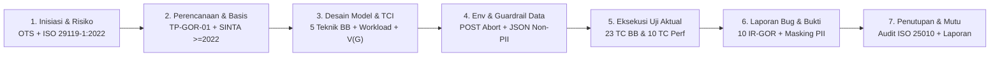

# Tugas Testing dan QA Perangkat Lunak

Repositori dokumentasi tugas kelompok mata kuliah **Testing dan Quality Assurance (QA) Perangkat Lunak** — Program Studi Teknik Informatika (S1), Universitas Pamulang.

- **Dosen Pengampu:** Asep Erlan Maulana, S.Kom., M.Kom
- **Kelas / Shift:** 07TPLE001 / Reguler C
- **Repositori:** https://github.com/BrongSkuy/tugas-qa-testing
- **Standar Acuan Resmi (`>= 2022`):** **ISO/IEC/IEEE 29119-1:2022**, **29119-5:2024**, **ISO/IEC 25010:2023**, **25019:2023**, **25002:2024**, **40500:2025 (W3C WCAG 2.2)**, & **ISTQB CTFL Syllabus v4.0.1 (`2024`)** — lihat [Katalog PDF & Tautan Resmi](./01-standar-ieee-iso/pdf-standar/README.md)

---

## Anggota Kelompok
> *Keempat anggota kelompok berikut tergabung sebagai tim QA kolaboratif dan kolaborator pada repositori GitHub ini.*

| No | Nama Lengkap | NIM | Akun GitHub |
| :--- | :--- | :--- | :--- |
| 1 | Muhammad Faiz Rabbani | 231011402539 | [@BrongSkuy](https://github.com/BrongSkuy) |
| 2 | Robi Farhan Anshori | 231011401468 | [@robifr](https://github.com/robifr) |
| 3 | Dzikri Attariq Samayaki | 221011401148 | [@meongasli](https://github.com/meongasli) |
| 4 | Nurlaelasari | 231011403531 | [@ela123-code](https://github.com/ela123-code) |

---

## Objek Pengujian UMKM Terpilih (Keputusan Final)

- **Nama Objek / Portal:** **Portal Booking GOR Permata Badminton Hall**
- **URL Portal:** https://gorpermatabadminton.com
- **Lokasi UMKM:** Kp. Cipari, Desa Ciakar, Kec. Panongan, Kab. Tangerang, Banten
- **Alasan Pemilihan & Cakupan Teknik:**
  - Sesuai 100% dengan contoh kasus dosen (*portal lapangan bulu tangkis skala lokal*).
  - Mendukung penuh pengujian berstandar **`>= 2022`**: **Black Box Testing (`5` Teknik Terpilih: EP, BVA, Decision Table, State Transition, Use Case & Compatibility)**, **Performance Testing** (*Web Vitals Cold/Warm Desktop/Mobile, Payload Audit, Client Interaction Latency, & Safe Concurrent `GET` Load `1/5/10 VUs`*), **White Box** (*Cyclomatic Complexity* $V(G)$ pada `normPhone()` & `submitBooking()`), **Gray Box**, dan **Automation Testing** (Playwright Python, `aiohttp`, & Cypress).
- **Batasan Etika Uji (Non-Destruktif):** Tidak pernah mengirimkan *booking* fiktif ke jadwal produksi (`POST /bookings/store` diblokir di interceptor `page.route` dengan `network_posts_sent_to_server = 0`; benchmark performa dibatasi `GET`-only `<= 10 VUs`).

---

## Flow Testing (*End-to-End* 7 Tahap Terurut)

Seluruh proses pengujian pada Portal GOR Permata berjalan berurutan melalui **7 tahap** dari perancangan berbasis risiko & jurnal ilmiah (`>= 2022`) hingga penutupan & audit mutu (*tersedia juga sebagai diagram visual di [`00_flow_testing_gor_permata.png`](./03-hasil-pengujian/evidence/screenshots/00_flow_testing_gor_permata.png) dan Bab II Laporan PDF*):



---

## Jenis Black Box Testing yang Dipakai & Alasan Pemilihannya

Tim QA menerapkan **5 teknik *Black Box* terstruktur** (*ISTQB CTFL v4.0.1 Bab 4.2* + literatur SINTA 2–3 `2022–2026` — rincian lengkap ada pada [`test-model-blackbox.md`](./02-objek-umkm-dan-rencana-uji/test-model-blackbox.md#15-pemilihan-5-jenis-teknik-black-box--alasan-pemilihannya)):

| No | Jenis Black Box | Alasan Teknis Pemilihan untuk GOR Permata | Fitur Uji & Hasil / Bug Tertangkap | Rujukan Ilmiah (`>= 2022`) |
| :-: | :--- | :--- | :--- | :--- |
| 1 | **Equivalence Partitioning (EP)** | Input rute URL, parameter `?start_date=`, variasi prefiks nomor WA (`08`/`628`/`8`/`+62 08`), & `/login` memiliki partisi valid dan invalid yang jelas untuk menghindari uji redundan. | Rute publik, query tanggal, & format WA (`TC-BB-01..05, 10, 15, 16, 20`) -> Menangkap **`IR-GOR-01` (`/register 404`)**, **`IR-GOR-02` (`+62 08...`)**, **`IR-GOR-05` (`2020-01-01`)**, **`IR-GOR-06` (`HTTP 500`)**. | *Desyani, dkk. (2022)* & *ISTQB v4.0.1 (§4.2.1)* |
| 2 | **Boundary Value Analysis (BVA)** | Logika JS portal menerapkan batas numerik ketat (`11–14` digit WA, durasi `1..5` jam, jam tutup `00:00`), tempat bug tepi paling sering terjadi. | Digit WA `10/11/14/15`, nama `0/1/3` spasi, jam tutup `22:00+2/3` jam (`TC-BB-07, 09, 11..14, 17..18`) -> Menangkap **`IR-GOR-03`** (`"   "` & `"A"` lolos tanpa `.trim()`). | *Putri & Susanto (2024)* & *ISTQB v4.0.1 (§4.2.2)* |
| 3 | **Decision Table Testing** | Fungsi `submitBooking()` memiliki 4 syarat kondisi berurutan sehingga kombinasi rule (`R1..R6`) harus dipetakan lengkap agar tidak ada kondisi yang lolos. | Validasi multi-kondisi `#bookingModal` (`TC-BB-08, 09, 17, 18`) -> Membuktikan deterministik rule `R6` (`IR-GOR-03`). | *Sitio, dkk. (2023)* & *ISTQB v4.0.1 (§4.2.3)* |
| 4 | **State Transition Testing (STT)** | Perilaku modal pemesanan & grid adalah perpindahan status UI (`Grid -> Modal -> Alert/BlockedFetch -> Reset`), serta klik slot `RTBC` -> dialog konfirmasi. | Transisi `#bookingModal` & slot biru `RTBC` (`TC-BB-06, 19, 23`) -> Memverifikasi reset form & pop-up asli `RTBC`. | *ISTQB CTFL v4.0.1 (§4.2.4)* |
| 5 | **Use Case & Compatibility (`WCAG 2.2`)** | Pengunjung memesan lewat HP maupun laptop; perlu uji alur menyeluruh pada viewport *Desktop* (`1280×800`) vs *Mobile* (`390×844`) dan privasi DOM publik. | Layout HP vs laptop & inspeksi DOM publik (`TC-BB-21, 22`) -> Menangkap **`IR-GOR-04` (`205` slot ekspos PII)** & **`IR-GOR-10` (navbar HP terpotong)**. | *Fhonna, dkk. (2026)*, *Seputra, dkk. (2024)*, & *ISO 40500:2025* |

> **Mengapa tidak memakai *Error Guessing* murni atau *Pairwise Testing* sebagai teknik utama?** *Error Guessing* tidak memiliki ukuran cakupan terstruktur sehingga hanya menjadi pelengkap, sementara *Pairwise/Orthogonal Array* cocok untuk puluhan parameter independen; pada GOR Permata hanya ada 4 kondisi validasi berurutan sehingga **Decision Table + BVA** memberi cakupan logika 100% lebih akurat.

---

## Panduan *Step-by-Step* Testing & Menjalankan Skrip

Panduan operasional lengkap (Mode Otomatis **Playwright/`aiohttp`** dan Mode Manual **Browser DevTools**, masing-masing `6` langkah konkret) tersedia pada [`test-case-blackbox.md`](./03-hasil-pengujian/test-case-blackbox.md#5-panduan-step-by-step-pelaksanaan-pengujian-black-box-manual--otomatis) dan [`test-case-performance.md`](./03-hasil-pengujian/test-case-performance.md#4-panduan-step-by-step-pelaksanaan-performance-testing-langkah-1-sd-6):

1. **Langkah 1 — Persiapan Lingkungan:** Instal `Python >= 3.9`, `playwright`, `aiohttp`, `python-docx`, `Pillow` (`pip install playwright aiohttp python-docx pillow && playwright install chromium`).
2. **Langkah 2 — Muat Data & Verifikasi Target:** Cek target aktif dan dataset sintetik non-PII ([`blackbox-testdata.json`](./03-hasil-pengujian/test-data/blackbox-testdata.json) & [`performance-profiles.json`](./03-hasil-pengujian/test-data/performance-profiles.json)).
3. **Langkah 3 — Aktifkan Guardrail Non-Destruktif:** Pastikan interceptor `page.route("**/bookings/store")` aktif (*atau Request Blocking di Chrome DevTools jika manual*) agar `0` data uji masuk ke database GOR Permata.
4. **Langkah 4 — Eksekusi Pengujian Black Box (`23 TC`):** Jalankan skrip otomasi untuk mengecek rute publik, query `start_date`, BVA WA & jam tutup, rule Decision Table, slot `RTBC`, privasi DOM, dan layout HP `390×844`.
5. **Langkah 5 — Eksekusi Performance Testing (`10 TC`):** Jalankan benchmark Web Vitals (*Cold/Warm Desktop/Mobile*), interaksi DOM lokal, dan beban `GET` aman `1 -> 5 -> 10 VUs` (`104` request).
6. **Langkah 6 — Verifikasi Log, Bukti Visual, & Pelaporan Bug:** Periksa hasil pada `execution-log.txt`, `performance-log.txt`, file JSON hasil, `12` bukti gambar (*PII dimasking `[TERISI]`*), lalu catat seluruh bug ke [`incident-reports.md`](./03-hasil-pengujian/incident-reports.md) dan regenerasi laporan resmi Word/PDF.

```bash
# 1. Suite Black Box Testing (23 TC, non-destruktif)
python 03-hasil-pengujian/automation-scripts/test_gor_permata.py

# 2. Suite Performance Testing (10 TC: Web Vitals + Concurrent GET 1/5/10 VUs)
python 03-hasil-pengujian/automation-scripts/test_performance_gor_permata.py

# 3. Regenerasi Diagram Flow Testing & Laporan Resmi Word & PDF ke folder 05-dokumentasi-laporan/
python 03-hasil-pengujian/generate_laporan_pengujian.py
```

---

## Daftar Referensi Resmi (`>= 2022`) — Klik Menuju File & Tautan Resmi

> **Kebijakan Referensi Minimal Tahun `2022` & Etika Hak Cipta ISO:** Berkas standar & jurnal pra-`2022` (`2019–2021`) telah **dihapus** dari repositori. Untuk standar **ISO/IEC** (`2022–2025`) yang naskah penuhnya berbayar/hak cipta ISO, repositori menyediakan **2 PDF standar terbuka gratis (`ISTQB v4.0.1 2024` & `W3C WCAG 2.2 / ISO 40500:2025`)**, **3 PDF ringkasan & audit standar (`2022–2025`)**, serta **tautan klik resmi ke katalog `iso.org`**. Seluruh **`9` PDF jurnal ilmiah SINTA 2–3 (`2022–2026`)** dapat diklik dan dibuka langsung dari GitHub ini.

### A. Standar Pengujian & Kualitas Perangkat Lunak (`>= 2022`)

| Kode / Nama Standar | Tahun | Akses Langsung Berkas PDF Lokal (Klik) | Tautan Resmi Online & Penerapan |
| :--- | :---: | :--- | :--- |
| **ISTQB CTFL Syllabus v4.0.1** | **2024** | [`ISTQB_CTFL_Syllabus_v4.0.1_2024.pdf`](./01-standar-ieee-iso/pdf-standar/ISTQB_CTFL_Syllabus_v4.0.1_2024.pdf) *(78 hlm.)* | [istqb.org CTFL v4.0](https://www.istqb.org/certifications/certified-tester-foundation-level-ctfl-v4-0/) — *Test Process* & *Black-Box EP/BVA/Decision Table/STT* |
| **ISO/IEC 40500:2025 (W3C WCAG 2.2)** | **2023 / 2025** | [`W3C_WCAG_2.2_Accessibility_2023_ISO_40500_2025.pdf`](./01-standar-ieee-iso/pdf-standar/W3C_WCAG_2.2_Accessibility_2023_ISO_40500_2025.pdf) *(96 hlm.)* | [`iso.org/standard/91029.html`](https://www.iso.org/standard/91029.html) & [W3C WCAG 2.2](https://www.w3.org/TR/WCAG22/) — Responsivitas Mobile (`IR-GOR-10`) |
| **ISO/IEC/IEEE 29119-1:2022** & **29119-5:2024** | **2022 & 2024** | [`Ringkasan-Standar-ISO-IEC-IEEE-29119-2022-2024.pdf`](./01-standar-ieee-iso/pdf-standar/Ringkasan-Standar-ISO-IEC-IEEE-29119-2022-2024.pdf) *(2 hlm.)* | [`29119-1:2022`](https://www.iso.org/standard/81291.html) & [`29119-5:2024`](https://www.iso.org/standard/87233.html) — Konsep Uji, Risiko, & Otomasi JSON |
| **ISO/IEC 25010:2023**, **25019:2023**, & **25002:2024** | **2023–2024** | [`Audit-Mutu-ISO-IEC-25010-2023-GOR-Permata.pdf`](./01-standar-ieee-iso/pdf-standar/Audit-Mutu-ISO-IEC-25010-2023-GOR-Permata.pdf) *(2 hlm.)* | [`25010:2023`](https://www.iso.org/standard/78176.html), [`25019:2023`](https://www.iso.org/standard/78177.html), [`25002:2024`](https://www.iso.org/standard/78175.html) — Audit 9 Dimensi Mutu & Safety |
| **Katalog Peta Standar `2022–2025`** | **2022–2025** | [`Referensi-Standar-ISO-Testing-dan-Kualitas-2022-2025.pdf`](./01-standar-ieee-iso/pdf-standar/Referensi-Standar-ISO-Testing-dan-Kualitas-2022-2025.pdf) *(1 hlm.)* | [Indeks Folder `pdf-standar/`](./01-standar-ieee-iso/pdf-standar/README.md) & [ISO OBP](https://www.iso.org/obp/ui/en/) |

### B. Referensi Jurnal Ilmiah Terakreditasi SINTA 2–3 (`2022–2026`) & Pengujian yang Diturunkan

| No | Penulis & Tahun | Peringkat | File PDF Resmi (Klik) & DOI | Metodologi & Implementasi Pengujian pada GOR Permata |
| :-: | :--- | :-: | :--- | :--- |
| 1 | **Desyani, dkk. (2022)** | **SINTA 3** | [`JTSI_Desyani_2022_BlackBox_EP.pdf`](./02-objek-umkm-dan-rencana-uji/pdf-jurnal/JTSI_Desyani_2022_BlackBox_EP.pdf) ([DOI](https://doi.org/10.32493/jtsi.v5i2.17578)) | **Black Box — Equivalence Partitioning (EP):** Memecah partisi rute publik, `?start_date=`, prefix WA (`TC-BB-01..05, 10, 15, 16, 20`) -> `IR-GOR-01, 02, 05, 06`. |
| 2 | **Sitio, dkk. (2023)** | **SINTA 3** | [`JIUP_Sitio_2023_BlackBox_CauseEffect.pdf`](./02-objek-umkm-dan-rencana-uji/pdf-jurnal/JIUP_Sitio_2023_BlackBox_CauseEffect.pdf) ([DOI](https://doi.org/10.32493/informatika.v8i1.26885)) | **Black Box — Cause-Effect & Decision Table:** Tabel keputusan 4 syarat (`R1..R6`) pada `submitBooking()` (`TC-BB-08, 09, 17, 18`) -> Bukti rule `R6` (`IR-GOR-03`). |
| 3 | **Nada, dkk. (2023)** | **SINTA 3** | [`JIUP_Nada_2023_WhiteBox_BasisPath.pdf`](./02-objek-umkm-dan-rencana-uji/pdf-jurnal/JIUP_Nada_2023_WhiteBox_BasisPath.pdf) ([DOI](https://doi.org/10.32493/informatika.v8i3.33711)) | **White Box — Basis Path & $V(G)$:** CFG & kompleksitas `normPhone()` $V(G)=4$ dan `submitBooking()` $V(G)=10$ -> Akar cacat `IR-GOR-02`. |
| 4 | **Seputra, dkk. (2024)** | **SINTA 2** | [`RESTI_Seputra_2024_WhiteBox_BlackBox.pdf`](./02-objek-umkm-dan-rencana-uji/pdf-jurnal/RESTI_Seputra_2024_WhiteBox_BlackBox.pdf) ([DOI](https://doi.org/10.29207/resti.v8i3.5707)) | **White + Black Box & Privasi Data:** Audit CSRF, DOM slot `manageBooking()` (`TC-BB-22`), & keamanan header -> Menangkap `IR-GOR-04` (`205` slot PII). |
| 5 | **Putri & Susanto (2024)** | **SINTA 3** | [`Sinkron_Putri_2024_BlackBox_BVA.pdf`](./02-objek-umkm-dan-rencana-uji/pdf-jurnal/Sinkron_Putri_2024_BlackBox_BVA.pdf) ([DOI](https://doi.org/10.33395/sinkron.v8i2.13589)) | **Black Box — Boundary Value Analysis (BVA):** Uji batas panjang WA `10/11/14/15` digit, nama `0/1/3` char, & tutup `00:00` (`TC-BB-09, 11..14, 17..18`). |
| 6 | **Alirridlo, dkk. (2025)** | **SINTA 2** | [`RESTI_Alirridlo_2025_ISO25010_Cyclomatic.pdf`](./02-objek-umkm-dan-rencana-uji/pdf-jurnal/RESTI_Alirridlo_2025_ISO25010_Cyclomatic.pdf) ([DOI](https://doi.org/10.29207/resti.v9i6.6825)) | **ISO/IEC 25010 Modularity & Cyclomatic Complexity:** Audit modularitas JS inline `7.473` char & 9 karakteristik mutu produk (`Maintainability`, `Security`). |
| 7 | **Fhonna, dkk. (2026)** | **SINTA 3** | [`Sisfo_Fhonna_2026_Cypress_Testing.pdf`](./02-objek-umkm-dan-rencana-uji/pdf-jurnal/Sisfo_Fhonna_2026_Cypress_Testing.pdf) ([DOI](https://doi.org/10.29103/sisfo.v10i1.27052)) | **E2E Automation & Task-Based Usability:** Pemodelan alur pengguna (*Use Case*, modal `RTBC`, responsivitas `390×844`, & `gor-permata.cy.js`) -> `IR-GOR-10`. |
| 8 | **Winasis, dkk. (2026)** | **SINTA 3** | [`Sinkron_Winasis_2026_LoadTesting_UAT.pdf`](./02-objek-umkm-dan-rencana-uji/pdf-jurnal/Sinkron_Winasis_2026_LoadTesting_UAT.pdf) ([DOI](https://doi.org/10.33395/sinkron.v10i2.15884)) | **Tiered Load Testing (Web + WhatsApp Laravel):** Desain skenario `1/5/10 VUs` (`104` GET req) -> Menangkap degradasi `p95 = 5314 ms` (`IR-GOR-07`). |
| 9 | **Putra, dkk. (2026)** | **SINTA 3** | [`JAIC_Putra_2026_Playwright_Cypress.pdf`](./02-objek-umkm-dan-rencana-uji/pdf-jurnal/JAIC_Putra_2026_Playwright_Cypress.pdf) ([OJS](https://jurnal.polibatam.ac.id/index.php/JAIC/article/view/13680)) | **Evaluasi Framework UI (Playwright vs Cypress vs Selenium):** Memilih **Playwright Python** sebagai runner utama E2E & Web Vitals (`TC-BB-01..23`, `TC-PERF-01..07`). |
| 10 | **Zahra & Kraugusteeliana (2023)** | **SINTA 2** | *(Tautan Resmi Online)* ([DOI](https://doi.org/10.25126/jtiik.2023106326)) | **Performance Efficiency ISO 25010:** Tolok ukur `TTFB`, `FCP`, payload HTML, dan kecepatan respon transaksi -> `IR-GOR-08` & `IR-GOR-09`. |

*(Rincian pemetaan ilmiah lengkap tersedia pada [`referensi-sinta-1-3.md`](./02-objek-umkm-dan-rencana-uji/referensi-sinta-1-3.md).)*

---

## Progres Pengerjaan Tugas Kelompok

| No | Langkah Kerja Kelompok | Penanggung Jawab | Status |
| :-: | :--- | :--- | :---: |
| 1 | Pengisian lengkap data keempat anggota kelompok (`07TPLE001 / Reguler C`) & pembaruan nama dosen pengampu. | Seluruh Anggota (`Tim QA`) | ✅ Selesai |
| 2 | Mengambil & mempelajari modul lengkap (Pertemuan 1–7 di [`00-materi-perkuliahan/`](./00-materi-perkuliahan/); Pertemuan 8–akhir menyusul dari Ketua Kelas). | Semua Anggota | ⏳ Proses |
| 3 | Membuat repositori GitHub *Public* (`https://github.com/BrongSkuy/tugas-qa-testing`), melengkapi [tabel anggota](./README.md#anggota-kelompok), & mengundang kolaborator (`@robifr`, `@meongasli`, `@ela123-code`). | Tim QA | ✅ Selesai |
| 4 | Finalisasi objek UMKM terpilih di repo: **Portal Booking GOR Permata Badminton Hall** ([`kandidat-objek-pengujian.md`](./02-objek-umkm-dan-rencana-uji/kandidat-objek-pengujian.md)). | Tim Riset Objek | ✅ Selesai |
| 5 | Menyusun standar QA minimal `2022` ([`01-standar-ieee-iso/`](./01-standar-ieee-iso/): `5` PDF standar `2022–2025` & audit `ISO 25010/25019/40500`) + **`9` PDF jurnal SINTA 2–3 (`2022–2026`)** ([`pdf-jurnal/`](./02-objek-umkm-dan-rencana-uji/pdf-jurnal/)). | Tim Dokumentasi & Riset | ✅ Selesai |
| 6 | Memfinalkan *Master Test Plan* (`TP-GOR-01` + **Flow Testing**), *Performance Test Plan*, **Justifikasi 5 Jenis Black Box**, & *White/Gray Box CFG* di [`02-objek-umkm-dan-rencana-uji/`](./02-objek-umkm-dan-rencana-uji/). | Tim QA & Riset | ✅ Selesai |
| 7 | Menjalankan pengujian aktual Black Box (`23 TC`: `16 PASS`, `7` temuan cacat) & Performance (`10 TC`: `7 PASS`, `3` temuan SLA/payload) + *Panduan Step-by-Step*, *Incident Reports* (`IR-GOR-01..10`), bukti `12+1` gambar/diagram & JSON ([`03-hasil-pengujian/`](./03-hasil-pengujian/)), serta **Laporan Resmi Word & PDF** di [`05-dokumentasi-laporan/`](./05-dokumentasi-laporan/). | Tim Penguji | ✅ Selesai |
| 8 | Menghubungi & mewawancarai 1 praktisi QA / Software Tester **SETELAH** *project* GOR Permata selesai ([`04-wawancara-praktisi-qa/`](./04-wawancara-praktisi-qa/), arahan dosen 14 Nov 2026). | Tim Wawancara | ⬜ Siap Dilaksanakan |

---

## Struktur Dokumen Repositori

- [`00-materi-perkuliahan/`](./00-materi-perkuliahan/) — Arsip modul materi perkuliahan (`Pertemuan 1–7.pptx`)
- [`01-standar-ieee-iso/`](./01-standar-ieee-iso/) — **Standar Resmi (`>= 2022`) & Audit Kualitas SQuaRE:**
  - [`organizational-test-specification.md`](./01-standar-ieee-iso/organizational-test-specification.md) — *Tailored Conformance*, *Organizational Test Policy*, & *Test Practices* (`OT1–OT3`)
  - [`standar-dokumentasi-qa.md`](./01-standar-ieee-iso/standar-dokumentasi-qa.md) — Matriks kepatuhan standar `>= 2022` (`29119-1/5`, `25010/25019/25002`, `40500`, `ISTQB v4.0.1`)
  - [`evaluasi-iso-25010-gor-permata.md`](./01-standar-ieee-iso/evaluasi-iso-25010-gor-permata.md) — Audit mutu `9` dimensi **ISO/IEC 25010:2023**, *Quality-in-Use* **25019:2023**, & **WCAG 2.2**
  - [`pdf-standar/`](./01-standar-ieee-iso/pdf-standar/README.md) — `5` berkas PDF standar & ringkasan (`2022–2025`) beserta tautan resmi `iso.org`
- [`02-objek-umkm-dan-rencana-uji/`](./02-objek-umkm-dan-rencana-uji/) — **Perencanaan (`TP-GOR-01`), Permodelan Uji, & Rujukan SINTA `2022–2026`:**
  - [`test-plan-gor-permata.md`](./02-objek-umkm-dan-rencana-uji/test-plan-gor-permata.md) — *Master Test Plan* (`TP-GOR-01`: **Flow Testing 7 Tahap**, risiko, jadwal, & persetujuan)
  - [`performance-test-plan.md`](./02-objek-umkm-dan-rencana-uji/performance-test-plan.md) — *Performance Test Plan* (`TP-GOR-PERF-01`: *Web Vitals*, *Workload `1/5/10 VUs`*, SLA, *Circuit Breaker*)
  - [`test-model-blackbox.md`](./02-objek-umkm-dan-rencana-uji/test-model-blackbox.md) — **Justifikasi 5 Teknik Black Box**, *Test Models* (`TM-BB-01..05`), & `TCI-BB-01..23`
  - [`test-model-performance.md`](./02-objek-umkm-dan-rencana-uji/test-model-performance.md) — *Test Basis*, *Workload/CWV Models* (`TM-PERF-01..03`), & `TCI-PERF-01..10`
  - [`analisis-white-black-gray-box.md`](./02-objek-umkm-dan-rencana-uji/analisis-white-black-gray-box.md) — *CFG* & $V(G)$ *White Box* (*Nada 2023; Alirridlo 2025*) serta analisis *Gray Box*
  - [`kandidat-objek-pengujian.md`](./02-objek-umkm-dan-rencana-uji/kandidat-objek-pengujian.md), [`referensi-sinta-1-3.md`](./02-objek-umkm-dan-rencana-uji/referensi-sinta-1-3.md), & [`pdf-jurnal/`](./02-objek-umkm-dan-rencana-uji/pdf-jurnal/) (`9` PDF `2022–2026`)
- [`03-hasil-pengujian/`](./03-hasil-pengujian/) — **Eksekusi Uji, *Step-by-Step*, Kontrol, & Penutupan:**
  - [`test-environment-dan-data.md`](./03-hasil-pengujian/test-environment-dan-data.md) & [`test-data/`](./03-hasil-pengujian/test-data/) — Kesiapan lingkungan & data uji (`ED1–ED4`, beda Test vs Ops)
  - [`test-case-blackbox.md`](./03-hasil-pengujian/test-case-blackbox.md) & [`test-case-performance.md`](./03-hasil-pengujian/test-case-performance.md) — Spesifikasi *Test Case*, *Traceability*, **Matriks Ilmiah**, & **Panduan Step-by-Step**
  - [`test-execution-log.md`](./03-hasil-pengujian/test-execution-log.md) — Rekaman hasil aktual vs ekspektasi (`TE1–TE3`)
  - [`incident-reports.md`](./03-hasil-pengujian/incident-reports.md) — Laporan `10` insiden terverifikasi (`IR-GOR-01..10`)
  - [`test-status-and-control-report.md`](./03-hasil-pengujian/test-status-and-control-report.md) & [`test-completion-report.md`](./03-hasil-pengujian/test-completion-report.md) — Pemantauan, *Control Directives*, & penutupan uji
  - [`test-cases-dan-laporan-bug.md`](./03-hasil-pengujian/test-cases-dan-laporan-bug.md) — Ringkasan eksekutif indeks hasil uji
  - [`generate_laporan_pengujian.py`](./03-hasil-pengujian/generate_laporan_pengujian.py) — Skrip generator diagram flow & laporan Word/PDF ke `05-dokumentasi-laporan/`
  - [`automation-scripts/`](./03-hasil-pengujian/automation-scripts/) & [`evidence/`](./03-hasil-pengujian/evidence/) — Skrip Playwright & `aiohttp`, Cypress, log TXT, metrik JSON, `00_flow_testing_gor_permata.png`, & `12` bukti visual (`01`–`12`)
- [`04-wawancara-praktisi-qa/`](./04-wawancara-praktisi-qa/) — Panduan wawancara praktisi QA *(siap dijalankan setelah fase `01`–`03` tuntas)*
- [`05-dokumentasi-laporan/`](./05-dokumentasi-laporan/) — **Arsip Dokumen Resmi Format Word (`.docx`) & PDF (`.pdf`):**
  - [`Laporan_Hasil_Pengujian_GOR_Permata_ISO29119.docx`](./05-dokumentasi-laporan/Laporan_Hasil_Pengujian_GOR_Permata_ISO29119.docx) — Laporan hasil pengujian lengkap format Microsoft Word
  - [`Laporan_Hasil_Pengujian_GOR_Permata_ISO29119.pdf`](./05-dokumentasi-laporan/Laporan_Hasil_Pengujian_GOR_Permata_ISO29119.pdf) — Laporan hasil pengujian lengkap format PDF dengan bahasa populer/mudah dipahami (`12` halaman, termasuk diagram *Flow Testing*, alasan 5 jenis Black Box, matriks ilmiah `>= 2022`, panduan *step-by-step*, & `12` bukti visual `01`–`12`)
