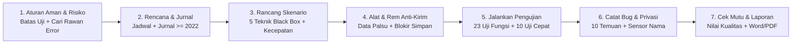

# Tugas Testing dan QA Perangkat Lunak

Repositori dokumentasi tugas kelompok mata kuliah **Testing dan Quality Assurance (QA) Perangkat Lunak** — Program Studi Teknik Informatika (S1), Universitas Pamulang.

- **Dosen Pengampu:** Asep Erlan Maulana, S.Kom., M.Kom
- **Kelas / Shift:** 07TPLE001 / Reguler C
- **Repositori:** https://github.com/BrongSkuy/tugas-qa-testing
- **Standar Acuan Resmi (`>= 2022`):** **ISO/IEC/IEEE 29119-1:2022**, **29119-5:2024**, **ISO/IEC 25010:2023**, **25019:2023**, **25002:2024**, **40500:2025 (W3C WCAG 2.2)**, & **ISTQB CTFL Syllabus v4.0.1 (`2024`)** — lihat [Katalog PDF & Tautan Resmi](./01-standar-ieee-iso/pdf-standar/README.md)

---

## Anggota Kelompok
> *Keempat anggota kelompok berikut tergabung sebagai tim QA kolaboratif dan kolaborator pada repositori GitHub ini.*

| No | Nama Lengkap | NIM | Akun GitHub |
| :--- | :--- | :--- | :--- |
| 1 | Muhammad Faiz Rabbani | 231011402539 | [@BrongSkuy](https://github.com/BrongSkuy) |
| 2 | Robi Farhan Anshori | 231011401468 | [@robifr](https://github.com/robifr) |
| 3 | Dzikri Attariq Samayaki | 221011401148 | [@meongasli](https://github.com/meongasli) |
| 4 | Nurlaelasari | 231011403531 | [@ela123-code](https://github.com/ela123-code) |

---

## Objek Pengujian UMKM Terpilih (Keputusan Final)

- **Nama Objek / Portal:** **Portal Booking GOR Permata Badminton Hall**
- **URL Portal:** https://gorpermatabadminton.com
- **Lokasi UMKM:** Kp. Cipari, Desa Ciakar, Kec. Panongan, Kab. Tangerang, Banten
- **Jenis Pengujian yang Digunakan (`2` Pengujian Utama):**
  1. **Black Box Testing (`23` Skenario):** Memakai `5` teknik terpilih (*Equivalence Partitioning, Boundary Value Analysis, Decision Table, State Transition, Use Case & Compatibility*) untuk memeriksa seluruh tombol, formulir, aturan jam buka-tutup, kebocoran data halaman, dan tampilan HP vs Laptop.
  2. **Performance Testing (`10` Skenario):** Mengukur kecepatan muat halaman (*Web Vitals* di laptop & HP), berat ukuran halaman, kecepatan respons klik tombol, serta simulasi aman **`1`, `5`, dan `10` orang** membuka web bersamaan (`GET`).
- **Alat Otomasi & Catatan Pendukung (Bukan Pengujian Terpisah):** Seluruh pengujian *Black Box* dan *Performance* di atas dijalankan otomatis memakai **Playwright Python** dan **`aiohttp`** (disertai contoh skrip `gor-permata.cy.js`). Catatan pada [`analisis-white-black-gray-box.md`](./02-objek-umkm-dan-rencana-uji/analisis-white-black-gray-box.md) hanya berfungsi sebagai **pendukung baca kode tampilan `/booking`** untuk mencari tahu baris penyebab bug yang ditemukan di *Black Box* (seperti mengapa format `+62 08...` ditolak).
- **Batasan Etika Uji (Non-Destruktif):** Tidak pernah mengirimkan *booking* fiktif ke jadwal produksi (`POST /bookings/store` diblokir di interceptor `page.route` dengan `network_posts_sent_to_server = 0`; benchmark performa dibatasi `GET`-only `<= 10 VUs`).

---

## Flow Testing (Alur Pengujian Lengkap 7 Tahap)

Agar pengujian rapi, terarah, dan tidak merusak website UMKM yang sedang aktif dipakai pelanggan, seluruh proses uji dilakukan urut melalui **7 tahap** berikut (tersedia sebagai gambar diagram di [`00_flow_testing_gor_permata.png`](./03-hasil-pengujian/evidence/screenshots/00_flow_testing_gor_permata.png) dan penjelasannya di laporan PDF):



#### Penjelasan Flow Testing dalam Bahasa Sederhana (Tahap 1 s.d. Tahap 7)

1. **Tahap 1 — Menentukan Aturan Main Aman & Bagian Paling Berisiko (*Inisiasi & Risiko*):** Tim sepakat hanya menguji halaman yang memang terbuka untuk umum (seperti beranda, jadwal, login, fasilitas) dan **dilarang mengirim pesanan sungguhan ke database** maupun mengutak-atik menu admin agar bisnis GOR Permata tetap aman. Pada tahap ini juga dicatat fitur apa saja yang paling rawan bermasalah, misalnya salah format nomor WhatsApp, salah hitung tarif, dan halaman lambat (*dokumen: `organizational-test-specification.md`*).
2. **Tahap 2 — Membuat Rencana Kerja & Mencari Rujukan Ilmiah (`>= 2022`):** Tim menyusun rencana pengujian utama (`TP-GOR-01`) dan rencana uji kecepatan (`TP-GOR-PERF-01`), menentukan target batas nyaman, lalu mengambil dasar metode dari **9 PDF jurnal terakreditasi SINTA (`2022–2026`)**, **ISTQB CTFL v4.0.1 (`2024`)**, dan standar **ISO `2022–2025`** (*dokumen: `test-plan-gor-permata.md`, `referensi-sinta-1-3.md`*).
3. **Tahap 3 — Merancang Skenario & Memilih 5 Cara Uji (*Desain Model*):** Tim menyusun daftar hal yang harus dicek memakai **5 teknik Black Box** (membagi input benar vs salah, mengetes angka batas minimum/maksimum, menyusun tabel aturan formulir, mengecek perpindahan tampilan pop-up, serta memeriksa kerapian di HP dan laptop) ditambah simulasi kecepatan untuk `1`, `5`, hingga `10` pengunjung sekaligus (*dokumen: `test-model-blackbox.md`, `test-model-performance.md`, `analisis-white-black-gray-box.md`*).
4. **Tahap 4 — Menyiapkan Alat Uji & Rem Pengaman Data Asli:** Tim menyiapkan program uji otomatis (Python + browser Chrome otomatis) serta data uji buatan (seperti nama `"Test QA"` dan nomor WA fiktif agar tidak memakai data pelanggan asli). Yang terpenting, dipasang **"rem otomatis" (`page.route`) di browser** untuk memutus proses kirim ke server, sehingga **0 data uji palsu** bisa masuk ke jadwal GOR Permata (*dokumen: `test-environment-dan-data.md`, `test-data/*.json`*).
5. **Tahap 5 — Menjalankan Pengujian Otomatis & Mengecek Manual:** Tim menjalankan skrip uji untuk mengetes **`23` skenario fungsi fitur (`TC-BB-01..23`)** dan **`10` skenario kecepatan (`TC-PERF-01..10`)** di layar laptop maupun HP, ditambah pengecekan manual langsung di browser agar hasilnya 100% pasti (*dokumen: `test-execution-log.md`, `*.json`*).
6. **Tahap 6 — Mencatat 10 Bug Ditemukan & Menyensor Data Pelanggan:** Setiap masalah yang ketahuan (total **`10` masalah / `IR-GOR-01..10`**) ditulis lengkap langkah memunculkannya beserta saran perbaikannya. Sebelum foto bukti disimpan, nama pelanggan asli di tabel jadwal **disensor menjadi `[TERISI]`** supaya privasi pengunjung GOR Permata tetap terjaga (*dokumen: `incident-reports.md`, `evidence/screenshots/*.png`*).
7. **Tahap 7 — Menilai Kualitas Website Secara Utuh & Membuat Laporan Akhir:** Tim mengecek apakah seluruh target uji sudah selesai 100%, merangkum kondisi kualitas website menggunakan standar terbaru (**ISO/IEC 25010:2023 & 25019:2023**), lalu menyusun **Laporan Resmi Word & PDF** yang siap dipakai saat presentasi maupun wawancara dengan praktisi QA (*dokumen: `test-completion-report.md`, `evaluasi-iso-25010-gor-permata.md`, `05-dokumentasi-laporan/`*).

> *Catatan Alur Balik:* Jika saat mengetes di Tahap 5–6 ditemukan kasus baru (seperti tombol menu terpotong di layar HP), kami kembali ke Tahap 3 untuk menambahkan skenario tersebut agar ikut teruji rapi.

---

## Jenis Black Box Testing yang Dipakai & Alasan Memilihnya

Untuk menguji portal pesan lapangan bulu tangkis seperti GOR Permata, kami memilih **5 teknik *Black Box*** agar seluruh tombol, isian formulir, aturan jam buka-tutup, hingga tampilan HP benar-benar teruji (*rincian lengkap: [`test-model-blackbox.md`](./02-objek-umkm-dan-rencana-uji/test-model-blackbox.md#15-mengapa-memilih-5-jenis-teknik-black-box-ini-penjelasan-sederhana)*):

| No | Jenis Black Box | Penjelasan Sederhana & Alasan Dipakai di GOR Permata | Contoh yang Diuji & Bug yang Ketahuan | Rujukan Ilmiah (`>= 2022`) |
| :-: | :--- | :--- | :--- | :--- |
| 1 | **Equivalence Partitioning (EP)** | **Bagi kelompok input benar vs salah.** Daripada mencoba semua kemungkinan satu per satu, input dikelompokkan (misalnya awalan WA `08`, `628`, `8`, `+62 08`, atau tanggal benar vs rusak). | Uji semua menu utama & format nomor WA (`TC-BB-01..05, 10, 15, 16, 20`) -> Ketahuan **`/register` error `404`** (`IR-GOR-01`), **`+62 08...` ditolak** (`IR-GOR-02`), tanggal lampau masih bisa dipesan (`IR-GOR-05`), & tanggal rusak bikin **server error `500`** (`IR-GOR-06`). | *Desyani, dkk. (2022)* & *ISTQB v4.0.1 (§4.2.1)* |
| 2 | **Boundary Value Analysis (BVA)** | **Uji tepat di angka batas paling kecil & paling besar.** Program paling sering salah tepat di batas pinggir (misal aturan WA `11–14` digit atau batas GOR tutup jam `00:00`). | Uji WA **`10`, `11`, `14`, `15` digit**, nama spasi/`1` huruf, & main jam `22:00` selama **`2` jam vs `3` jam** (`TC-BB-07, 09, 11..14, 17..18`) -> Ketahuan nama **cuma spasi `"   "` atau 1 huruf `"A"` lolos dikirim** (`IR-GOR-03`). | *Putri & Susanto (2024)* & *ISTQB v4.0.1 (§4.2.2)* |
| 3 | **Decision Table Testing** | **Buat tabel aturan formulir (*jika-maka*).** Sebelum booking dikirim, website mengecek `4` syarat berurutan (nama terisi, WA terisi, format WA benar, jam tidak lewat tutup). Tabel ini menjamin semua kombinasi dicek. | Cek semua syarat tombol `Booking Sekarang` (`TC-BB-08, 09, 17, 18`) -> Membuktikan secara pasti celah aturan nama spasi (`IR-GOR-03`). | *Sitio, dkk. (2023)* & *ISTQB v4.0.1 (§4.2.3)* |
| 4 | **State Transition Testing (STT)** | **Cek perubahan kondisi layar/pop-up.** Saat slot diklik, layar berpindah dari jadwal -> modal pesan terbuka -> muncul peringatan / diblokir -> kembali bersih setelah ditutup. Termasuk klik kotak `RTBC`. | Buka-tutup formulir pesan & klik slot biru `RTBC` (`TC-BB-06, 19, 23`) -> Memastikan kolom isian bersih lagi saat ditutup & pop-up *"SUDAH DIKONFIRMASI"* muncul benar. | *ISTQB CTFL v4.0.1 (§4.2.4)* |
| 5 | **Use Case & Compatibility (`WCAG 2.2`)** | **Cek alur lengkap di HP vs Laptop + privasi halaman.** Pelanggan biasa pesan pakai HP, sehingga tampilan harus rapi di layar HP (`390×844`) dan tidak membocorkan nomor HP pemesan lain di kode web. | Cek tampilan HP vs laptop & kode halaman jadwal (`TC-BB-21, 22`) -> Ketahuan **menu atas beranda di HP terpotong** (`IR-GOR-10`) & **kode web menampilkan `205` nomor WA + nama pemesan lain** (`IR-GOR-04`). | *Fhonna, dkk. (2026)*, *Seputra, dkk. (2024)*, & *ISO 40500:2025* |

> **Kenapa tidak sekadar menebak error acak atau mengetes semua kombinasi sekaligus?** Kalau hanya menebak secara acak (*Error Guessing*), ada bagian yang rawan terlewat dan sulit dibuktikan kelengkapannya. Sebaliknya, teknik kombinasi massal (*Pairwise*) baru dibutuhkan jika ada puluhan pilihan sekaligus; karena formulir booking ini hanya punya `4` syarat berurutan, gabungan **EP + BVA + Decision Table** sudah menguji semuanya dengan lebih cepat dan tepat sasaran.

---

## Panduan *Step-by-Step* Menguji & Menjalankan Skrip

Cara mengikuti pengujian langkah demi langkah (tersedia versi lengkap Mode Otomatis & Mode Manual tanpa koding di [`test-case-blackbox.md`](./03-hasil-pengujian/test-case-blackbox.md#5-panduan-step-by-step-cara-melakukan-pengujian-otomatis--manual) dan [`test-case-performance.md`](./03-hasil-pengujian/test-case-performance.md#4-panduan-step-by-step-menguji-kecepatan-website)):

1. **Langkah 1 — Siapkan Alat di Komputer:** Pastikan `Python >= 3.9` dan browser uji terpasang (`pip install playwright aiohttp python-docx pillow && playwright install chromium`).
2. **Langkah 2 — Cek Website & Data Uji Buatan:** Pastikan `https://gorpermatabadminton.com` bisa dibuka normal dan gunakan data uji palsu pada [`blackbox-testdata.json`](./03-hasil-pengujian/test-data/blackbox-testdata.json) serta [`performance-profiles.json`](./03-hasil-pengujian/test-data/performance-profiles.json) (tanpa data asli pelanggan).
3. **Langkah 3 — Pasang Rem Anti-Kirim Data Asli:** Pastikan pemblokiran alamat `**/bookings/store` aktif otomatis di skrip (atau lewat menu *Request Blocking* di Chrome DevTools jika mengetes manual), supaya **0 booking palsu** masuk ke database pemilik lapangan.
4. **Langkah 4 — Jalankan Uji Fungsi (`23` Skenario Black Box):** Skrip mengecek seluruh link halaman, manipulasi tanggal URL, hitungan harga 1–5 jam, batas nomor WA & jam tutup `00:00`, kotak konfirmasi `RTBC`, kebocoran data halaman, dan kerapian layar HP.
5. **Langkah 5 — Jalankan Uji Kecepatan & Keramaian (`10` Skenario Performance):** Skrip mengukur berapa detik halaman tampil di laptop & HP, seberapa cepat tombol diklik, serta menyimulasikan **`1`, `5`, dan `10` orang** membuka web bersamaan (hanya membaca halaman).
6. **Langkah 6 — Cek Hasil Log, Gambar Bukti, & Susun Laporan:** Lihat ringkasan lulus/gagal pada file log & JSON, pastikan semua nama orang lain di gambar disamarkan `[TERISI]`, catat seluruh masalah ke [`incident-reports.md`](./03-hasil-pengujian/incident-reports.md), lalu buat laporan Word & PDF resminya.

```bash
# 1. Jalankan 23 Uji Fungsi Black Box (aman, tidak mengirim booking ke server)
python 03-hasil-pengujian/automation-scripts/test_gor_permata.py

# 2. Jalankan 10 Uji Kecepatan & Simulasi 1/5/10 Pengunjung Bersamaan
python 03-hasil-pengujian/automation-scripts/test_performance_gor_permata.py

# 3. Buat ulang gambar Flow Testing & Laporan Resmi Word + PDF ke folder 05-dokumentasi-laporan/
python 03-hasil-pengujian/generate_laporan_pengujian.py
```

---

## Daftar Referensi Resmi (`>= 2022`) — Klik Menuju File & Tautan Resmi

> **Kebijakan Referensi Minimal Tahun `2022` & Etika Hak Cipta ISO:** Berkas standar & jurnal pra-`2022` (`2019–2021`) telah **dihapus** dari repositori. Untuk standar **ISO/IEC** (`2022–2025`) yang naskah penuhnya berbayar/hak cipta ISO, repositori menyediakan **2 PDF standar terbuka gratis (`ISTQB v4.0.1 2024` & `W3C WCAG 2.2 / ISO 40500:2025`)**, **3 PDF ringkasan & audit standar (`2022–2025`)**, serta **tautan klik resmi ke katalog `iso.org`**. Seluruh **`9` PDF jurnal ilmiah SINTA 2–3 (`2022–2026`)** dapat diklik dan dibuka langsung dari GitHub ini.

### A. Standar Pengujian & Kualitas Perangkat Lunak (`>= 2022`)

| Kode / Nama Standar | Tahun | Akses Langsung Berkas PDF Lokal (Klik) | Tautan Resmi Online & Penerapan |
| :--- | :---: | :--- | :--- |
| **ISTQB CTFL Syllabus v4.0.1** | **2024** | [`ISTQB_CTFL_Syllabus_v4.0.1_2024.pdf`](./01-standar-ieee-iso/pdf-standar/ISTQB_CTFL_Syllabus_v4.0.1_2024.pdf) *(78 hlm.)* | [istqb.org CTFL v4.0](https://www.istqb.org/certifications/certified-tester-foundation-level-ctfl-v4-0/) — *Test Process* & *Black-Box EP/BVA/Decision Table/STT* |
| **ISO/IEC 40500:2025 (W3C WCAG 2.2)** | **2023 / 2025** | [`W3C_WCAG_2.2_Accessibility_2023_ISO_40500_2025.pdf`](./01-standar-ieee-iso/pdf-standar/W3C_WCAG_2.2_Accessibility_2023_ISO_40500_2025.pdf) *(96 hlm.)* | [`iso.org/standard/91029.html`](https://www.iso.org/standard/91029.html) & [W3C WCAG 2.2](https://www.w3.org/TR/WCAG22/) — Responsivitas Mobile (`IR-GOR-10`) |
| **ISO/IEC/IEEE 29119-1:2022** & **29119-5:2024** | **2022 & 2024** | [`Ringkasan-Standar-ISO-IEC-IEEE-29119-2022-2024.pdf`](./01-standar-ieee-iso/pdf-standar/Ringkasan-Standar-ISO-IEC-IEEE-29119-2022-2024.pdf) *(2 hlm.)* | [`29119-1:2022`](https://www.iso.org/standard/81291.html) & [`29119-5:2024`](https://www.iso.org/standard/87233.html) — Konsep Uji, Risiko, & Otomasi JSON |
| **ISO/IEC 25010:2023**, **25019:2023**, & **25002:2024** | **2023–2024** | [`Audit-Mutu-ISO-IEC-25010-2023-GOR-Permata.pdf`](./01-standar-ieee-iso/pdf-standar/Audit-Mutu-ISO-IEC-25010-2023-GOR-Permata.pdf) *(2 hlm.)* | [`25010:2023`](https://www.iso.org/standard/78176.html), [`25019:2023`](https://www.iso.org/standard/78177.html), [`25002:2024`](https://www.iso.org/standard/78175.html) — Audit 9 Dimensi Mutu & Safety |
| **Katalog Peta Standar `2022–2025`** | **2022–2025** | [`Referensi-Standar-ISO-Testing-dan-Kualitas-2022-2025.pdf`](./01-standar-ieee-iso/pdf-standar/Referensi-Standar-ISO-Testing-dan-Kualitas-2022-2025.pdf) *(1 hlm.)* | [Indeks Folder `pdf-standar/`](./01-standar-ieee-iso/pdf-standar/README.md) & [ISO OBP](https://www.iso.org/obp/ui/en/) |

### B. Referensi Jurnal Ilmiah Terakreditasi SINTA 2–3 (`2022–2026`) & Pengujian yang Diturunkan

| No | Penulis & Tahun | Peringkat | File PDF Resmi (Klik) & DOI | Metodologi & Implementasi Pengujian pada GOR Permata |
| :-: | :--- | :-: | :--- | :--- |
| 1 | **Desyani, dkk. (2022)** | **SINTA 3** | [`JTSI_Desyani_2022_BlackBox_EP.pdf`](./02-objek-umkm-dan-rencana-uji/pdf-jurnal/JTSI_Desyani_2022_BlackBox_EP.pdf) ([DOI](https://doi.org/10.32493/jtsi.v5i2.17578)) | **Black Box — Equivalence Partitioning (EP):** Memecah partisi rute publik, `?start_date=`, prefix WA (`TC-BB-01..05, 10, 15, 16, 20`) -> `IR-GOR-01, 02, 05, 06`. |
| 2 | **Sitio, dkk. (2023)** | **SINTA 3** | [`JIUP_Sitio_2023_BlackBox_CauseEffect.pdf`](./02-objek-umkm-dan-rencana-uji/pdf-jurnal/JIUP_Sitio_2023_BlackBox_CauseEffect.pdf) ([DOI](https://doi.org/10.32493/informatika.v8i1.26885)) | **Black Box — Cause-Effect & Decision Table:** Tabel keputusan 4 syarat (`R1..R6`) pada `submitBooking()` (`TC-BB-08, 09, 17, 18`) -> Bukti rule `R6` (`IR-GOR-03`). |
| 3 | **Nada, dkk. (2023)** | **SINTA 3** | [`JIUP_Nada_2023_WhiteBox_BasisPath.pdf`](./02-objek-umkm-dan-rencana-uji/pdf-jurnal/JIUP_Nada_2023_WhiteBox_BasisPath.pdf) ([DOI](https://doi.org/10.32493/informatika.v8i3.33711)) | **Pendukung Black Box (Cek Alur Kode JS Tampilan):** Membantu melacak baris logika `normPhone()` di `/booking` -> Menjelaskan akar penyebab `IR-GOR-02` (`+62 08...`). |
| 4 | **Seputra, dkk. (2024)** | **SINTA 2** | [`RESTI_Seputra_2024_WhiteBox_BlackBox.pdf`](./02-objek-umkm-dan-rencana-uji/pdf-jurnal/RESTI_Seputra_2024_WhiteBox_BlackBox.pdf) ([DOI](https://doi.org/10.29207/resti.v8i3.5707)) | **Black Box & Privasi Data Halaman:** Pengecekan token form, alur antar-halaman, dan kebocoran atribut `data-phone` (`TC-BB-22`) -> Menangkap `IR-GOR-04` (`205` slot). |
| 5 | **Putri & Susanto (2024)** | **SINTA 3** | [`Sinkron_Putri_2024_BlackBox_BVA.pdf`](./02-objek-umkm-dan-rencana-uji/pdf-jurnal/Sinkron_Putri_2024_BlackBox_BVA.pdf) ([DOI](https://doi.org/10.33395/sinkron.v8i2.13589)) | **Black Box — Boundary Value Analysis (BVA):** Uji batas panjang WA `10/11/14/15` digit, nama `0/1/3` char, & tutup `00:00` (`TC-BB-09, 11..14, 17..18`). |
| 6 | **Alirridlo, dkk. (2025)** | **SINTA 2** | [`RESTI_Alirridlo_2025_ISO25010_Cyclomatic.pdf`](./02-objek-umkm-dan-rencana-uji/pdf-jurnal/RESTI_Alirridlo_2025_ISO25010_Cyclomatic.pdf) ([DOI](https://doi.org/10.29207/resti.v9i6.6825)) | **ISO/IEC 25010 Modularity & Cyclomatic Complexity:** Audit modularitas JS inline `7.473` char & 9 karakteristik mutu produk (`Maintainability`, `Security`). |
| 7 | **Fhonna, dkk. (2026)** | **SINTA 3** | [`Sisfo_Fhonna_2026_Cypress_Testing.pdf`](./02-objek-umkm-dan-rencana-uji/pdf-jurnal/Sisfo_Fhonna_2026_Cypress_Testing.pdf) ([DOI](https://doi.org/10.29103/sisfo.v10i1.27052)) | **E2E Automation & Task-Based Usability:** Pemodelan alur pengguna (*Use Case*, modal `RTBC`, responsivitas `390×844`, & `gor-permata.cy.js`) -> `IR-GOR-10`. |
| 8 | **Winasis, dkk. (2026)** | **SINTA 3** | [`Sinkron_Winasis_2026_LoadTesting_UAT.pdf`](./02-objek-umkm-dan-rencana-uji/pdf-jurnal/Sinkron_Winasis_2026_LoadTesting_UAT.pdf) ([DOI](https://doi.org/10.33395/sinkron.v10i2.15884)) | **Tiered Load Testing (Web + WhatsApp Laravel):** Desain skenario `1/5/10 VUs` (`104` GET req) -> Menangkap degradasi `p95 = 5314 ms` (`IR-GOR-07`). |
| 9 | **Putra, dkk. (2026)** | **SINTA 3** | [`JAIC_Putra_2026_Playwright_Cypress.pdf`](./02-objek-umkm-dan-rencana-uji/pdf-jurnal/JAIC_Putra_2026_Playwright_Cypress.pdf) ([OJS](https://jurnal.polibatam.ac.id/index.php/JAIC/article/view/13680)) | **Evaluasi Framework UI (Playwright vs Cypress vs Selenium):** Memilih **Playwright Python** sebagai runner utama E2E & Web Vitals (`TC-BB-01..23`, `TC-PERF-01..07`). |
| 10 | **Zahra & Kraugusteeliana (2023)** | **SINTA 2** | *(Tautan Resmi Online)* ([DOI](https://doi.org/10.25126/jtiik.2023106326)) | **Performance Efficiency ISO 25010:** Tolok ukur `TTFB`, `FCP`, payload HTML, dan kecepatan respon transaksi -> `IR-GOR-08` & `IR-GOR-09`. |

*(Rincian pemetaan ilmiah lengkap tersedia pada [`referensi-sinta-1-3.md`](./02-objek-umkm-dan-rencana-uji/referensi-sinta-1-3.md).)*

---

## Progres Pengerjaan Tugas Kelompok

| No | Langkah Kerja Kelompok | Penanggung Jawab | Status |
| :-: | :--- | :--- | :---: |
| 1 | Pengisian lengkap data keempat anggota kelompok (`07TPLE001 / Reguler C`) & pembaruan nama dosen pengampu. | Seluruh Anggota (`Tim QA`) | ✅ Selesai |
| 2 | Mengambil & mempelajari modul lengkap (Pertemuan 1–7 di [`00-materi-perkuliahan/`](./00-materi-perkuliahan/); Pertemuan 8–akhir menyusul dari Ketua Kelas). | Semua Anggota | ⏳ Proses |
| 3 | Membuat repositori GitHub *Public* (`https://github.com/BrongSkuy/tugas-qa-testing`), melengkapi [tabel anggota](./README.md#anggota-kelompok), & mengundang kolaborator (`@robifr`, `@meongasli`, `@ela123-code`). | Tim QA | ✅ Selesai |
| 4 | Finalisasi objek UMKM terpilih di repo: **Portal Booking GOR Permata Badminton Hall** ([`kandidat-objek-pengujian.md`](./02-objek-umkm-dan-rencana-uji/kandidat-objek-pengujian.md)). | Tim Riset Objek | ✅ Selesai |
| 5 | Menyusun standar QA minimal `2022` ([`01-standar-ieee-iso/`](./01-standar-ieee-iso/): `5` PDF standar `2022–2025` & audit `ISO 25010/25019/40500`) + **`9` PDF jurnal SINTA 2–3 (`2022–2026`)** ([`pdf-jurnal/`](./02-objek-umkm-dan-rencana-uji/pdf-jurnal/)). | Tim Dokumentasi & Riset | ✅ Selesai |
| 6 | Memfinalkan rencana **Black Box Testing** & **Performance Testing** (**Flow Testing 7 Tahap**, alasan 5 jenis Black Box, & catatan pendukung JS) di [`02-objek-umkm-dan-rencana-uji/`](./02-objek-umkm-dan-rencana-uji/). | Tim QA & Riset | ✅ Selesai |
| 7 | Menjalankan pengujian aktual Black Box (`23 TC`: `16 PASS`, `7` temuan cacat) & Performance (`10 TC`: `7 PASS`, `3` temuan SLA/payload) + *Panduan Step-by-Step*, *Incident Reports* (`IR-GOR-01..10`), bukti `12+1` gambar/diagram & JSON ([`03-hasil-pengujian/`](./03-hasil-pengujian/)), serta **Laporan Resmi Word & PDF** di [`05-dokumentasi-laporan/`](./05-dokumentasi-laporan/). | Tim Penguji | ✅ Selesai |
| 8 | Menghubungi & mewawancarai 1 praktisi QA / Software Tester **SETELAH** *project* GOR Permata selesai ([`04-wawancara-praktisi-qa/`](./04-wawancara-praktisi-qa/), arahan dosen 14 Nov 2026). | Tim Wawancara | ⬜ Siap Dilaksanakan |

---

## Struktur Dokumen Repositori

- [`00-materi-perkuliahan/`](./00-materi-perkuliahan/) — Arsip modul materi perkuliahan (`Pertemuan 1–7.pptx`)
- [`01-standar-ieee-iso/`](./01-standar-ieee-iso/) — **Standar Resmi (`>= 2022`) & Audit Kualitas SQuaRE:**
  - [`organizational-test-specification.md`](./01-standar-ieee-iso/organizational-test-specification.md) — *Tailored Conformance*, *Organizational Test Policy*, & *Test Practices* (`OT1–OT3`)
  - [`standar-dokumentasi-qa.md`](./01-standar-ieee-iso/standar-dokumentasi-qa.md) — Matriks kepatuhan standar `>= 2022` (`29119-1/5`, `25010/25019/25002`, `40500`, `ISTQB v4.0.1`)
  - [`evaluasi-iso-25010-gor-permata.md`](./01-standar-ieee-iso/evaluasi-iso-25010-gor-permata.md) — Audit mutu `9` dimensi **ISO/IEC 25010:2023**, *Quality-in-Use* **25019:2023**, & **WCAG 2.2**
  - [`pdf-standar/`](./01-standar-ieee-iso/pdf-standar/README.md) — `5` berkas PDF standar & ringkasan (`2022–2025`) beserta tautan resmi `iso.org`
- [`02-objek-umkm-dan-rencana-uji/`](./02-objek-umkm-dan-rencana-uji/) — **Perencanaan (`TP-GOR-01`), Permodelan Uji, & Rujukan SINTA `2022–2026`:**
  - [`test-plan-gor-permata.md`](./02-objek-umkm-dan-rencana-uji/test-plan-gor-permata.md) — *Master Test Plan* (`TP-GOR-01`: **Flow Testing 7 Tahap**, risiko, jadwal, & persetujuan)
  - [`performance-test-plan.md`](./02-objek-umkm-dan-rencana-uji/performance-test-plan.md) — *Performance Test Plan* (`TP-GOR-PERF-01`: *Web Vitals*, *Workload `1/5/10 VUs`*, SLA, *Circuit Breaker*)
  - [`test-model-blackbox.md`](./02-objek-umkm-dan-rencana-uji/test-model-blackbox.md) — **Justifikasi 5 Teknik Black Box**, *Test Models* (`TM-BB-01..05`), & `TCI-BB-01..23`
  - [`test-model-performance.md`](./02-objek-umkm-dan-rencana-uji/test-model-performance.md) — *Test Basis*, *Workload/CWV Models* (`TM-PERF-01..03`), & `TCI-PERF-01..10`
  - [`analisis-white-black-gray-box.md`](./02-objek-umkm-dan-rencana-uji/analisis-white-black-gray-box.md) — Catatan pendukung membaca kode JS publik `/booking` (*membantu menjelaskan penyebab bug Black Box*)
  - [`kandidat-objek-pengujian.md`](./02-objek-umkm-dan-rencana-uji/kandidat-objek-pengujian.md), [`referensi-sinta-1-3.md`](./02-objek-umkm-dan-rencana-uji/referensi-sinta-1-3.md), & [`pdf-jurnal/`](./02-objek-umkm-dan-rencana-uji/pdf-jurnal/) (`9` PDF `2022–2026`)
- [`03-hasil-pengujian/`](./03-hasil-pengujian/) — **Eksekusi Uji, *Step-by-Step*, Kontrol, & Penutupan:**
  - [`test-environment-dan-data.md`](./03-hasil-pengujian/test-environment-dan-data.md) & [`test-data/`](./03-hasil-pengujian/test-data/) — Kesiapan lingkungan & data uji (`ED1–ED4`, beda Test vs Ops)
  - [`test-case-blackbox.md`](./03-hasil-pengujian/test-case-blackbox.md) & [`test-case-performance.md`](./03-hasil-pengujian/test-case-performance.md) — Spesifikasi *Test Case*, *Traceability*, **Matriks Ilmiah**, & **Panduan Step-by-Step**
  - [`test-execution-log.md`](./03-hasil-pengujian/test-execution-log.md) — Rekaman hasil aktual vs ekspektasi (`TE1–TE3`)
  - [`incident-reports.md`](./03-hasil-pengujian/incident-reports.md) — Laporan `10` insiden terverifikasi (`IR-GOR-01..10`)
  - [`test-status-and-control-report.md`](./03-hasil-pengujian/test-status-and-control-report.md) & [`test-completion-report.md`](./03-hasil-pengujian/test-completion-report.md) — Pemantauan, *Control Directives*, & penutupan uji
  - [`test-cases-dan-laporan-bug.md`](./03-hasil-pengujian/test-cases-dan-laporan-bug.md) — Ringkasan eksekutif indeks hasil uji
  - [`generate_laporan_pengujian.py`](./03-hasil-pengujian/generate_laporan_pengujian.py) — Skrip generator diagram flow & laporan Word/PDF ke `05-dokumentasi-laporan/`
  - [`automation-scripts/`](./03-hasil-pengujian/automation-scripts/) & [`evidence/`](./03-hasil-pengujian/evidence/) — Skrip Playwright & `aiohttp`, Cypress, log TXT, metrik JSON, `00_flow_testing_gor_permata.png`, & `12` bukti visual (`01`–`12`)
- [`04-wawancara-praktisi-qa/`](./04-wawancara-praktisi-qa/) — Panduan wawancara praktisi QA *(siap dijalankan setelah fase `01`–`03` tuntas)*
- [`05-dokumentasi-laporan/`](./05-dokumentasi-laporan/) — **Arsip Dokumen Resmi Format Word (`.docx`) & PDF (`.pdf`):**
  - [`Laporan_Hasil_Pengujian_GOR_Permata_ISO29119.docx`](./05-dokumentasi-laporan/Laporan_Hasil_Pengujian_GOR_Permata_ISO29119.docx) — Laporan hasil pengujian lengkap format Microsoft Word
  - [`Laporan_Hasil_Pengujian_GOR_Permata_ISO29119.pdf`](./05-dokumentasi-laporan/Laporan_Hasil_Pengujian_GOR_Permata_ISO29119.pdf) — Laporan hasil pengujian lengkap format PDF dengan bahasa populer/mudah dipahami (`13` halaman, termasuk diagram *Flow Testing* + uraian teks 7 tahap, alasan 5 jenis Black Box, matriks ilmiah `>= 2022`, panduan *step-by-step*, & `12` bukti visual `01`–`12`)
